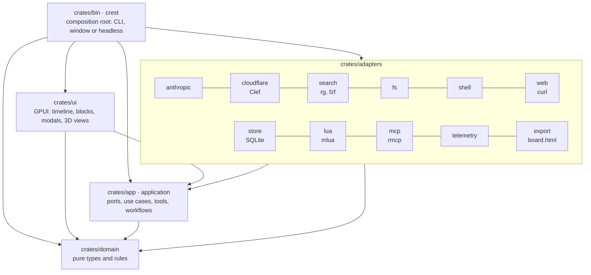

<div align="center">


# crest

**The coding agent that shows its work.**

A native, GPU-rendered workspace for Claude: it reads, searches and edits your code with your approval,<br>
and answers with charts, tables, diagrams, diffs and 3D models instead of a wall of text.


</div>

> [!WARNING]
> **crest is a work in progress.** It is usable day to day, but it is young: expect rough edges, missing features and breaking changes between releases. Some parts have only been tested with mocks (see [what is verified](docs/status.md)). Feedback and bug reports are very welcome.

## Why crest

<table>
<tr>
<td width="33%" valign="top"><b>A timeline, not a transcript</b><br>Every reply, tool call, diff, chart, table and diagram is a block you can expand, sort, zoom and copy.</td>
<td width="33%" valign="top"><b>From a problem to a reviewed commit</b><br>A 14-stage research flow turns a problem into a Spec, and an implementation flow ships it task by task.</td>
<td width="33%" valign="top"><b>Simulate before you build</b><br>Run a Spec's scenarios on a 3D circuit board and see where the design fails before writing code.</td>
</tr>
<tr>
<td valign="top"><b>You approve every change</b><br>Edits and commands wait for you, with the exact diff or command line. Allow once, always, or never.</td>
<td valign="top"><b>Smart routing, smaller bills</b><br>An optional decision model (Cloudflare Clef) picks the tools and the model of each prompt in milliseconds.</td>
<td valign="top"><b>Make it yours</b><br>Lua config and plugins: tools, commands, hooks, keymaps, blocks and modals, in a sandbox with explicit capabilities.</td>
</tr>
</table>

## A timeline, not a transcript

The agent answers with real components, drawn natively on the GPU: bar, line, area and pie charts (press `t` for the data behind them), sortable tables, Mermaid diagrams with pan and zoom, colored diffs, rendered markdown and the blocks your plugins define.


## From a problem to a reviewed commit

`/research <problem>` runs a guided investigation: it observes the code, gathers evidence, forms and ranks hypotheses, writes a measurable definition and a Spec with its plan. It stops at gates for your answer, and resumes where it left off. `/implement <spec>` then runs the plan one task at a time, with one commit per task and a final report.


## You approve every change

Nothing touches your files or runs a command without asking (unless you choose `auto-edit`). The dialog shows the exact diff or command line; `y` approves, `a` always approves that file or command, `n` rejects. A `plan` mode lets the agent read but never write.

Secrets and personal data never leave your machine by accident: API keys, tokens, private keys, passwords, emails, cards, IBANs and national ids in tool results and in your prompts are masked as `[REDACTED:kind]` before the model, the timeline or the saved session see them. [What is masked](docs/configuration.md#privacy-secrets-and-personal-data).


## Simulate before you build

`/simulate <spec>` turns a Spec into an executable model: assertions first, from its test protocol, then the model from its diagrams. It runs every scenario deterministically and opens a 3D board where messages travel between components, with a timeline, failure markers and a state inspector. The verdicts go back into the Spec, and `board.html` shares the replay with anyone.


## Open anything

`/open @path` shows any file of the workspace in a modal: highlighted code, rendered markdown, JSON trees, Mermaid, diffs, pictures with zoom, and **3D models** (OBJ, STL and PLY) in an orbit viewer. Plugins open the same modals with their own content.

<table>
<tr>
<td width="50%"></td>
<td width="50%"></td>
</tr>
</table>

## Smart routing, smaller bills

With Cloudflare credentials, a small **decision model** ([Clef](https://developers.cloudflare.com/workers-ai/models/clef-flash/)) answers typed questions in milliseconds for a fraction of a cent:

- **which tools** each prompt needs, so the model gets a shorter, cheaper request;
- **which model** answers it: a quick one for a greeting, a strong one for a redesign;
- **what you meant** at the flows' gates ("looks good, go on"), and whether a problem definition is measurable.

Without credentials crest works exactly as before. [How to turn it on](docs/configuration.md#decision-model-cloudflare-clef).

With [rtk](https://github.com/rtk-ai/rtk) installed, `app.opt.rtk = true` compacts the output of `git`, `cargo`, test runners and other common commands before the model reads it. [How it works](docs/configuration.md#compact-command-output-with-rtk).


## Make it yours

Configuration and plugins are Lua, with Neovim-style key notation. A plugin can add tools for the model, `/` commands, hooks around every tool call, keymaps, timeline blocks and modal windows:

```lua
local app = require("app")

app.commands.register("standup", function()
  app.send("Summarize what changed since yesterday from `git log`.", { role = "plan" })
end, { desc = "Draft my standup" })

app.keymap.set("<leader>s", function() app.cmd("standup") end)
```

Plugins run in a sandbox (no files, no network, instruction and memory limits). The ones that need an API or a program declare `network:` or `shell:` capabilities, which stay off until you approve them.

**Try the demo plugin**: [`examples/plugins/showcase`](examples/plugins/showcase/init.lua) shows every extension point in one file. Add it to `~/.config/crest/init.lua` and type `/demo`:

```lua
app.plugins = { "~/path/to/crest/examples/plugins/showcase" }
```

## Everything in one place

`F1` (or `/help`) opens one searchable window with every `/` command, the key bindings, the agent's tools and their effects, the plugins and their capabilities, the MCP servers, the models in use, the command-line flags and the paths crest reads.


## Install

**One line** (Linux x86_64, macOS Apple Silicon or Intel; no sudo):

```bash
curl -fsSL https://raw.githubusercontent.com/lazaroMB/crest/main/scripts/install.sh | sh
```

It downloads the [latest release](https://github.com/lazaroMB/crest/releases/latest), checks its checksum and installs crest as an app: in the app menu on Linux (GNOME, KDE and other XDG desktops), in `~/Applications` on macOS (Launchpad, Spotlight, Dock), plus the `crest` command in `~/.local/bin`. `sh -s -- --version v0.12.1` picks a release, `--uninstall` removes it. The release tarballs carry the same script: extract one and run `./install.sh`. The macOS app is not signed yet; the installer removes the Gatekeeper quarantine.

**Windows** (10 1809 or newer, x86_64; no administrator rights), in PowerShell:

```powershell
irm https://raw.githubusercontent.com/lazaroMB/crest/main/scripts/install.ps1 | iex
```

It installs `crest.exe` in `%LOCALAPPDATA%\Programs\crest`, adds it to your user `PATH` and to the Start menu; `install.ps1 -Uninstall` removes it. Install `rg`, `fzf` and `git` too (`winget install BurntSushi.ripgrep.MSVC junegunn.fzf Git.Git`). The Windows build is new and has only been tested in CI: reports are welcome.

Opened from the app menu or the Dock, crest gets the environment of your login shell (`~/.zprofile`, `~/.profile`), not the one of `~/.zshrc`: keep the API key in the keyring (below).

**From source** (Rust 1.99+):

```bash
git clone https://github.com/lazaroMB/crest && cd crest
make deps       # installs what is missing: rg, fzf, the GPUI libraries...
make install    # the same app install, from your build (make uninstall removes it)
```

Then open crest and give it an API key: without one the window asks for it (or run `/login`). It can be an Anthropic key, or an OpenCode key (an OpenCode Go subscription or Zen credits) to use models such as `opencode-go:glm-5.3`; `Tab` switches between them in the dialog. The account you log in to last serves the chat; with OpenCode, crest then lists the models of your plan and you pick one (`/model` or `Ctrl+G m` changes it later). The key is checked with the provider and stored in the system keyring (GNOME Keyring, KWallet, the macOS Keychain or the Windows Credential Manager), never in a file; `/logout` deletes it. From a terminal you can also store it yourself or use the environment:

```bash
secret-tool store --label="crest" service crest username ANTHROPIC_API_KEY   # Linux (OPENCODE_API_KEY likewise)
security add-generic-password -s crest -a ANTHROPIC_API_KEY -w               # macOS
# or: export ANTHROPIC_API_KEY=sk-ant-...   (opened from the app menu, crest only sees it in ~/.profile or ~/.zprofile)
```

Providers, prefixed model ids and how to point the roles at OpenCode models are in [docs/configuration.md](docs/configuration.md#model-providers-and-api-keys).

Requirements, every `make` target and the repository layout are in [docs/development.md](docs/development.md).

## Quick start

```bash
crest ~/src/my-project     # open a workspace
crest                      # or pick a recent project
crest --headless "find where the config is parsed and explain it" --workspace .
```

- Type a prompt and press `Enter` (`Shift+Enter` for a new line). `↑` brings back what you sent before.
- `/` opens the command palette: `/research`, `/implement`, `/simulate`, `/open @file`, `/model`, `/mode`, `/!git status`...
- `Ctrl+G` is the leader: `Ctrl+G ff` finds a file, `Ctrl+G fg` greps, `Ctrl+G e` shows the tree, `Ctrl+G m` picks a model.
- `Esc` always brings you back to the prompt; `F1` shows everything else.

Opening crest again in the same directory resumes the last session; `crest --new` starts a fresh one.

## Documentation

| Guide | What is in it |
| --- | --- |
| [Usage](docs/usage.md) | The window, every key and `/` command, approvals, blocks, the CLI, headless mode and sessions. |
| [Configuration](docs/configuration.md) | API keys, `app.opt`, models by role, the decision model, permissions and a full `init.lua`. |
| [Plugins](docs/plugins.md) | Writing Lua plugins: tools, hooks, blocks, modals, MCP and capabilities. |
| [Workflows](docs/workflows.md) | Research, simulation and implementation, stage by stage. |
| [Architecture](docs/architecture.md) | Layers, ports and adapters, the loop of a turn, persistence. |
| [Development](docs/development.md) | Requirements, `make` targets, tests, fakes, conventions and CI. |
| [Vision](docs/vision.md) | Where crest is going: principles and roadmap. |
| [Status](docs/status.md) | What is verified, what is not, and what is missing. |

## Built with

Rust (edition 2024), [GPUI](https://www.gpui.rs/) and [gpui-component](https://github.com/longbridge/gpui-component) for the native UI, wgpu for the 3D views, Lua 5.4 (mlua) for config and plugins, SQLite for sessions and flows, `rg` and `fzf` for search, and the Anthropic API.

crest follows a hexagonal architecture: the domain and the use cases know nothing about GPUI, HTTP, Lua or SQLite, every port has an in-memory fake for the tests, and `make arch` enforces the boundaries.



## Vision and roadmap

crest is heading to **your project and your sessions** (compatible with `AGENTS.md` and `CLAUDE.md`, session tabs as in tmux, context and cost you can see, a definition of done), then **pipelines written in Lua** and **any model**, local ones included, then **review and trust** (a review panel, sandboxed commands, workspace trust). Read the [vision and roadmap](docs/vision.md).

## Status and license

crest is a **work in progress** by TwoCrest Systems. [docs/status.md](docs/status.md) lists what has been verified, what has not, and the known limitations.

crest is free software: you can redistribute it and modify it under the terms of the [GNU General Public License](LICENSE), version 3 or (at your option) any later version. For a commercial license, contact TwoCrest Systems. Third-party code keeps its own license: see [THIRD-PARTY.md](THIRD-PARTY.md).
