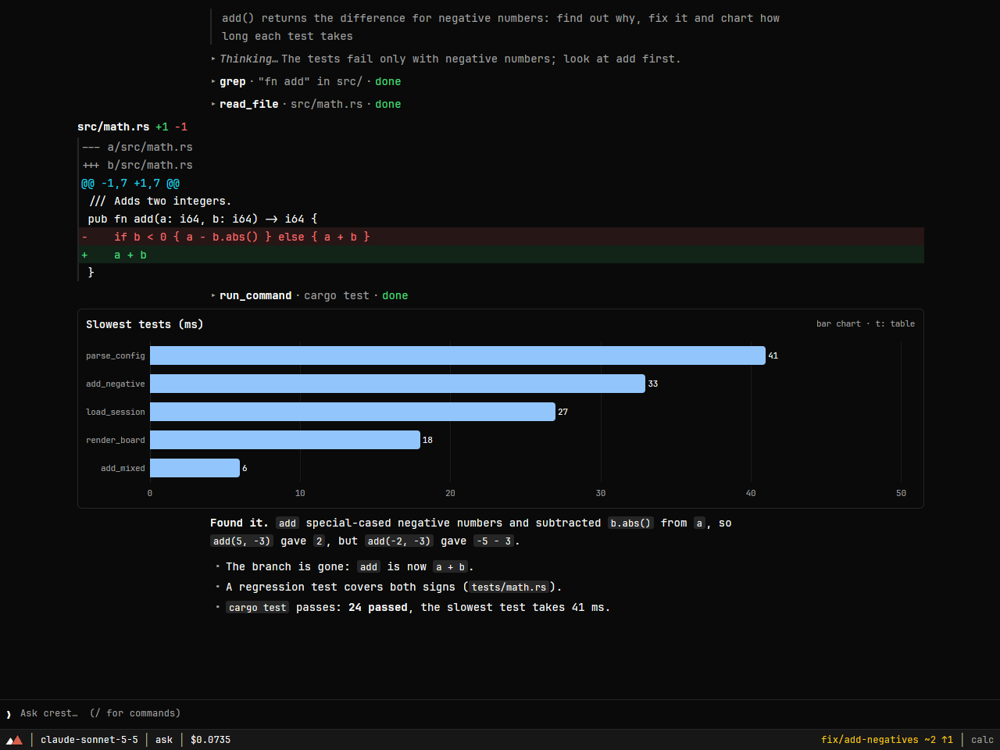
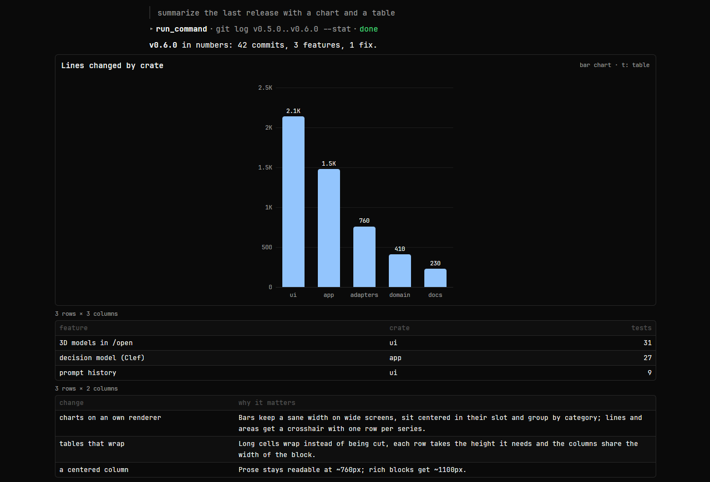
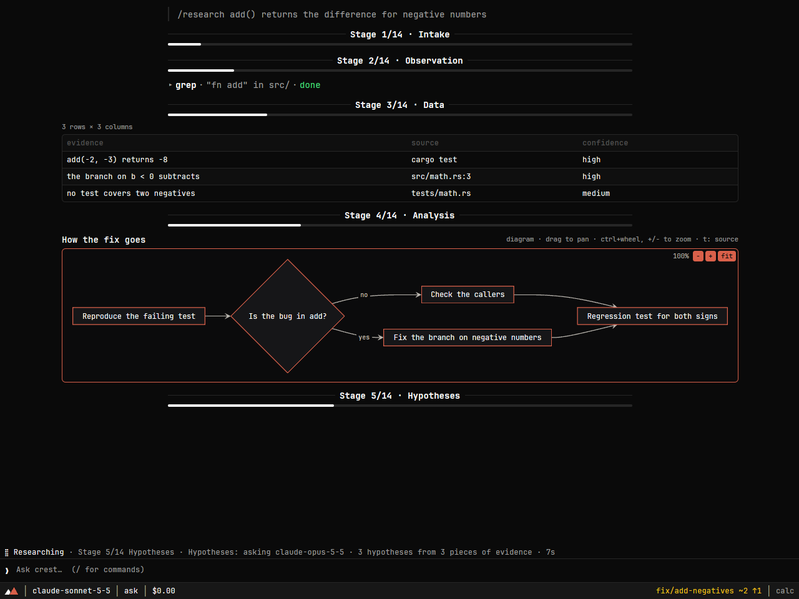
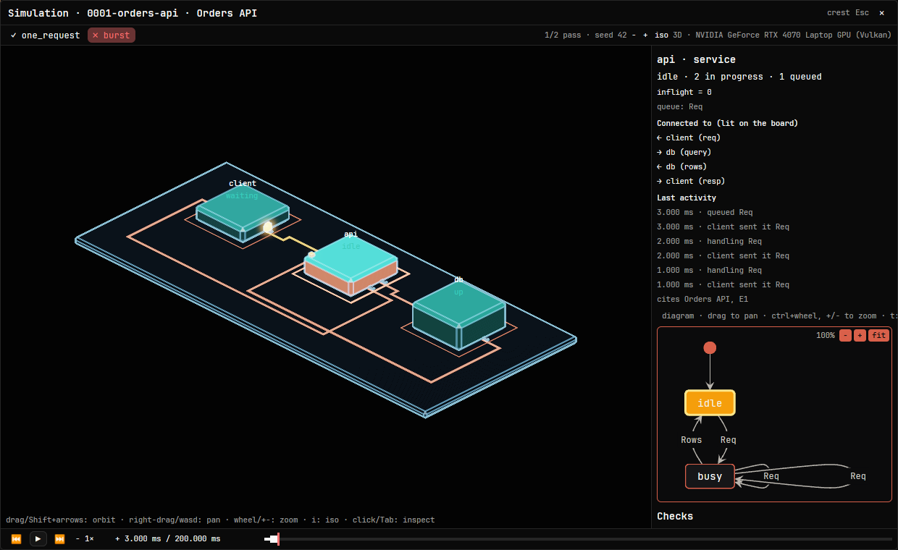
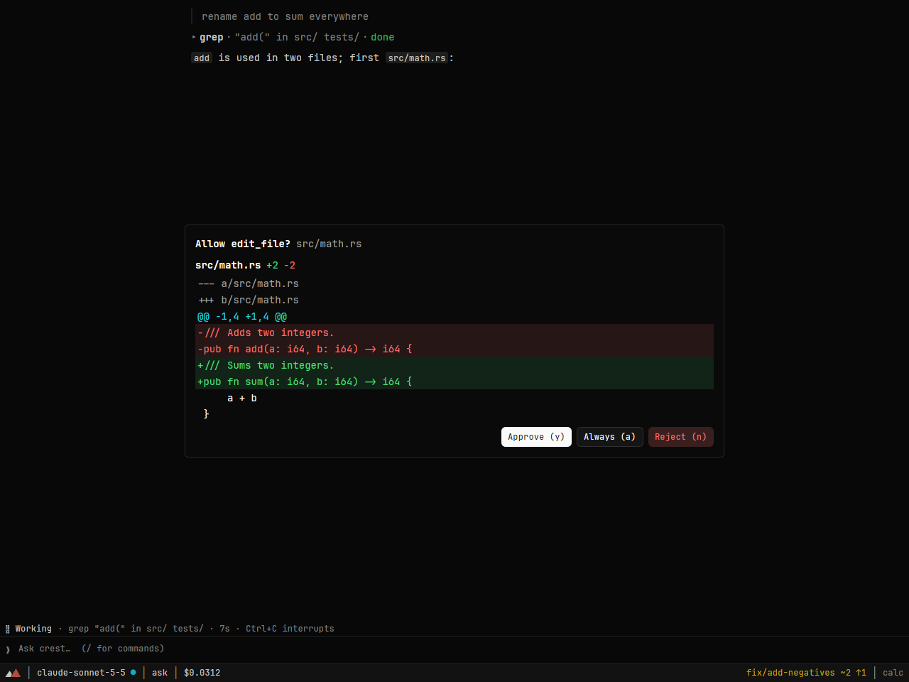
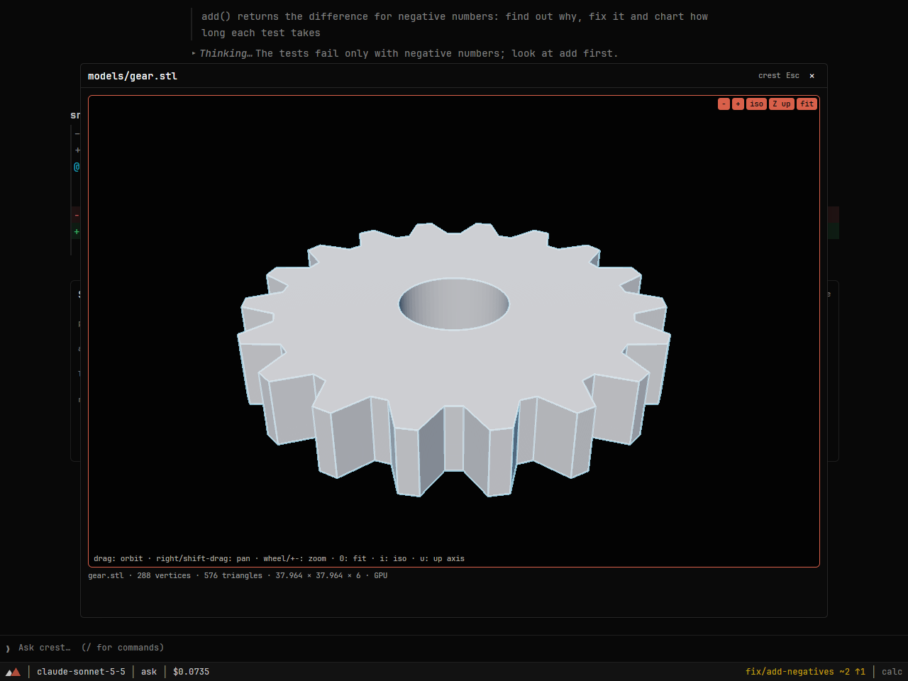
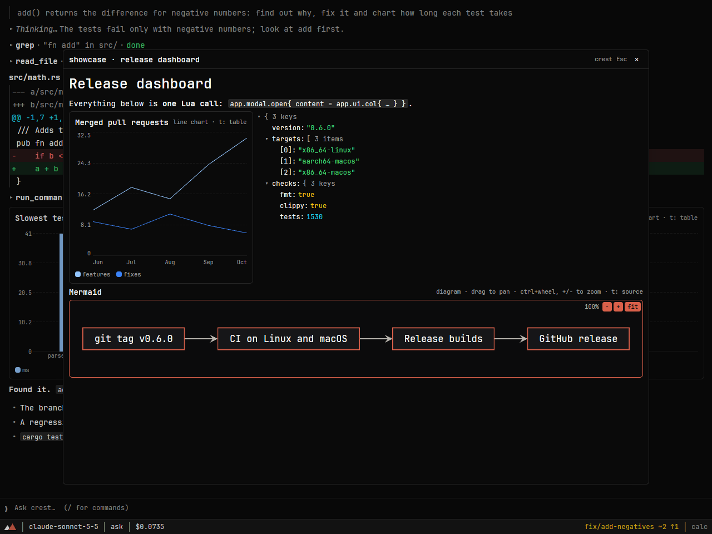
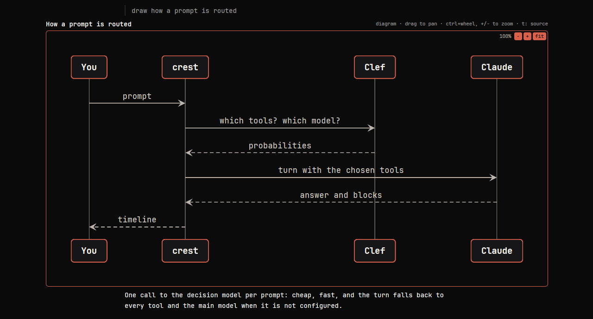
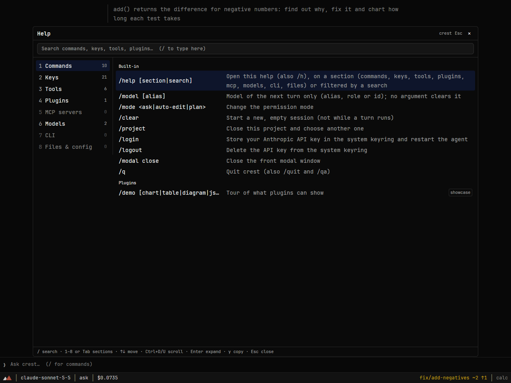
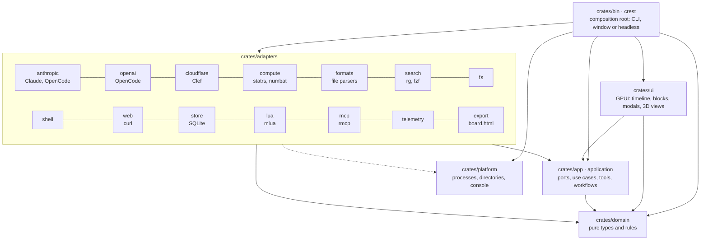

<div align="center">


# crest

**The coding agent that shows its work and checks its numbers.**

A native, GPU-rendered workspace for Claude and the OpenCode models. It reads, searches and edits your code with your approval,<br>
answers with charts, diffs, test reports, traces and calculations an engine has verified, and walks a problem from research to Spec to commits.




</div>

> [!WARNING]
> **crest is a work in progress.** It is usable day to day, but it is young: expect rough edges, missing features and breaking changes between releases. Some parts have only been tested with mocks (see [what is verified](docs/status.md)). Feedback and bug reports are very welcome.

**Contents**

- [Why crest](#why-crest)
- Features: [a timeline, not a transcript](#a-timeline-not-a-transcript) · [blocks for technical work](#blocks-for-technical-work) · [numbers you can verify](#numbers-you-can-verify) · [from a problem to a Spec to commits](#from-a-problem-to-a-spec-to-commits)
- More: [you approve every change](#you-approve-every-change) · [open anything](#open-anything) · [smart routing, smaller bills](#smart-routing-smaller-bills) · [everything in one place](#everything-in-one-place)
- Extend it: [connect any MCP server](#connect-any-mcp-server) · [make it yours](#make-it-yours) · [write a plugin](#write-a-plugin) · [themes](#themes)
- [Claude and OpenCode](#claude-and-opencode): [Claude](#claude) · [OpenCode](#opencode) · [both at once](#both-at-once)
- [Install](#install) · [Quick start](#quick-start) · [Documentation](#documentation)
- [Built with](#built-with) · [Vision and roadmap](#vision-and-roadmap) · [Status and license](#status-and-license)

## Why crest

<table>
<tr>
<td width="33%" valign="top"><b>A timeline, not a transcript</b><br>Every reply, tool call, diff, chart, test report and trace is a block you can expand, sort, zoom and copy. 48 kinds, drawn natively on the GPU.</td>
<td width="33%" valign="top"><b>Numbers you can verify</b><br>The model decides what to compute; a deterministic engine computes it. Each card shows only engine numbers, with their provenance, a Recompute button and a line to reproduce them in Python or R.</td>
<td width="33%" valign="top"><b>From problem to Spec to commits</b><br><code>/research</code> writes a Spec and a plan, <code>/simulate</code> runs its scenarios on a 3D board, <code>/implement</code> commits task by task. Gates wait for your answer and survive a restart.</td>
</tr>
<tr>
<td valign="top"><b>You approve every change</b><br>Edits and commands wait for you, with the exact diff or command line. Allow once, always, or never.</td>
<td valign="top"><b>Connect anything</b><br>Any MCP server, local or hosted, with a token or an OAuth login; web search and fetch run on your machine. Workspace servers wait until you trust them.</td>
<td valign="top"><b>Make it yours</b><br>Lua plugins add tools, commands, hooks, keymaps, blocks, computed cards, format readers, forms and modals, in a sandbox with explicit capabilities.</td>
</tr>
</table>

## A timeline, not a transcript

The agent answers with real components, drawn natively on the GPU: bar, line, area and pie charts (press `t` for the data behind them), sortable tables, Mermaid diagrams with pan and zoom, colored diffs, rendered markdown, JSON trees, images, the blocks your plugins define and [48 kinds of block in all](#blocks-for-technical-work). Replies and markdown typeset TeX math (inline `$..$`, display `$$..$$`, `\ce{}` for chemistry) on the text baseline ([math in text](docs/usage.md#math-in-text)).

The window keeps your work in sight. A **Chats** panel on the left lists every project and its chats, newest first: a click opens one, a right click renames or deletes it, a chat with a running turn shows its activity, and switching away parks the turn until you come back. A rail of marks on the right lists the questions you asked and jumps to any of them. `/project` (or `crest --pick`) changes project without closing the window. [The window](docs/usage.md#the-window).

Behind the blocks are about 60 builtin tools: files (`list_files`, `find_file`, `tree`, `grep`, `read_file`, `edit_file`, `write_file`, `run_command`), display (`show_chart`, `show_plot`, `show_table`, `show_mermaid`, `show_markdown` and 31 `show_*` readers for file formats), `ask_user` forms, 22 compute tools, `web_search` and `web_fetch` when `app.opt.web.enabled` is on (DuckDuckGo, Brave or SearXNG, run with `curl` on your machine), a read-only `task` subagent for exploring, `simulate_solution`, plus whatever your MCP servers and plugins add. [Agent tools](docs/usage.md#agent-tools) · [web search](docs/configuration.md#web-search).



## Blocks for technical work

Point the agent at a test report, a trace, a dataset, a CAD part or a molecule and it shows the file in the block that fits it. The block is computed from the file, not from the model's memory, and the model gets a summary (counts, the hottest path, the failing cases, the errors), never the raw rows.

| If you work on | Blocks | From | In the block |
| --- | --- | --- | --- |
| Code and tests | Diff, Shell, TestReport, Findings, Benchmarks | JUnit XML, libtest and nextest JSON, SARIF, criterion, ANSI output | failures first, a click opens the file, a suggested fix shows as a diff |
| Data and statistics | Dataset, Plot, Computed, TrainingCurves, ArrayFile | CSV, TSV, JSON lines, Parquet, HDF5, NetCDF, inline columns | a profile per column, a slider per parameter, Recompute, an APA line |
| Services and performance | Trace, FlameGraph, Logs, QueryPlan, Har, TerraformPlan, Diagram | OTLP, Jaeger, Zipkin, folded stacks, pprof, JSON lines, logfmt, PostgreSQL `EXPLAIN`, HAR, DOT, SQL DDL | critical path, zoom into a frame, filter by level or `/regex/`, an ER diagram from the schema |
| Hardware and CAD | Waveform, Netlist, CadModel, Drawing, IfcSchedule, Material | VCD, FST, GHW, SPICE, KiCad, STEP, DXF, IFC | the 3D viewer, signals over time, a room schedule, a parts list |
| Chemistry and biology | Molecule, Molecule3d, MoleculeGrid, Reaction, Spectrum, Sequence, Plate, Ghs | SMILES, MOL, SDF, XYZ, PDB, JCAMP-DX, mzML, MGF, GenBank, FASTA, PubChem | formula and mass computed from the structure, a balanced reaction, a plasmid map, a 96- or 384-well heatmap |
| Planning and money | Gantt, GeoMap, Network, Form, and the Computed cards for cash flow, LP, Monte Carlo, decision matrices and BOM costs | CPM tasks, GeoJSON, inline inputs | the critical path of a plan, every IRR, duals per constraint, P5/P50/P95, a typed form answered in the chat |

The selected block offers a **copy as** row with the other forms it can take: TSV and CSV, the JSON of a plot, the failing tests of a report, the `file:line` list of findings, the SMILES and SVG of a molecule, the folded stacks of a flame graph, the APA line and the envelope JSON of a card. When the model needs structured answers it calls `ask_user` and a typed form appears in the chat (text, numbers with bounds, choices, dates); the turn waits, and you can park it and come back.


**Every block**: [the table in Usage](docs/usage.md#blocks) · [plots, reports, data, lab and operations](docs/usage.md#plots-reports-data-lab-and-operations-blocks) · [forms](docs/usage.md#forms-ask_user) · [why these blocks](docs/research/chat-blocks-for-technical-work.md).

## Numbers you can verify

The model decides what to compute. A deterministic engine computes it. The card shows only the engine's numbers, each with its provenance.

- **One block kind, 22 cards.** Descriptive statistics, hypothesis tests, regression, correlation, distributions, contingency tables, power, A/B tests, bootstrap, forecasts; calc sheets with units and unit conversions (numbat); linear and mixed-integer programs, equations, Monte Carlo and Fermi estimates, cash flows, decision matrices; and for engineers, Bode plots, Karnaugh maps, beams, tolerance stacks and BOM costs.
- **Provenance and Recompute.** The header shows the method and why it was chosen, and a chip with the engine, a BLAKE3 hash of the input and the time. **Recompute** runs the stored request again and marks the card `✓ Verified` or `✗ Mismatch · N values changed`, and `Stale input` when the data file changed.
- **No number is the model's guess.** The reply cites values through slots (`⟦id.p_value⟧`) that the timeline fills from the card. Any other number the model typed is counted in a chip under the reply, `⚠ N numbers not from an engine`.
- **Reproduce it elsewhere.** Every card carries lines for Lua, Python, R and the shell. The statistics engine is checked against NIST StRD and R reference values.

```text
v = 100 km/h
t = 90 min
d = v * t -> km
```

[Statistics and calculations](docs/usage.md#statistics-and-calculations) · [`app.compute` from a plugin](docs/plugins.md#appcompute-engine-computed-cards).

## From a problem to a Spec to commits

Three commands walk a problem through research, simulation and implementation inside the chat, stopping at gates you answer with a plain line.

| Command | What it does | What it leaves |
| --- | --- | --- |
| `/research <problem>` | The stages of the [Hashlabs X-Workflow](https://www.hashlabs.com/guides/en/methodology/X-Workflow.html): five by default, the full fourteen with `--deep`. | `.crest/specs/NNNN-slug/` with `spec.md`, `plan.json`, sources and a journal. |
| `/simulate <spec>` | Turns the Spec into an executable model, freezes the assertions of its test protocol and runs every scenario on an isometric 3D board. A failure comes with a counterexample. | `simulation/` with the model, the traces and a self-contained `board.html`. |
| `/implement <spec>` | Runs `plan.json` task by task with the agent, one commit per task, checks included. | One commit per task and a `report.md`. |

Every step is a checkpoint in SQLite: close crest and `/research resume` picks up where it stopped. `/stage`, `/back`, `/skip`, `/retry` and `/abort` steer the workflow; `/aside` opens a side chat to look something up before answering a gate, and `/flow` goes back with the answer. With the [decision model](#smart-routing-smaller-bills), crest tells a side question from an answer by itself. The same workflows run in a terminal with `--headless --research`, `--implement` or `--simulate`, with `--continue` to resume and `--yes` to approve tool calls. A simulation is a behavioural sketch, not a proof about the real system: it shows where a design breaks under its own assertions, with the state that breaks it.

<table>
<tr>
<td width="50%"></td>
<td width="50%"></td>
</tr>
</table>

**Read on**: [research workflow](docs/workflows.md#research-workflow) · [side questions](docs/workflows.md#side-questions) · [simulating a solution](docs/workflows.md#simulating-a-solution) · [implementation workflow](docs/workflows.md#implementation-workflow) · [the simulator](docs/research/solution-simulator.md).

## You approve every change

Nothing touches your files or runs a command without asking (unless you choose `auto-edit`). The dialog shows the exact diff or command line; `y` approves once, `s` allows a pattern such as `cargo test *` for the session, `p` saves it for the project in `.crest/permissions.local.toml` (where you can also write deny rules), `n` rejects; `/permissions` lists and removes the rules. [Approvals and patterns](docs/usage.md#approvals-and-permission-modes). A `plan` mode lets the agent read but never write. `app.opt.max_session_cost` caps what a session may spend, and `app.opt.pricing` gives the prices per model (without them the status bar counts tokens instead of dollars). [Cost and spending cap](docs/configuration.md#cost-and-spending-cap).

Secrets and personal data never leave your machine by accident: API keys, tokens, private keys, passwords, emails, cards, IBANs and national ids in tool results and in your prompts are masked as `[REDACTED:kind]` before the model, the timeline or the saved session see them. [What is masked](docs/configuration.md#privacy-secrets-and-personal-data).



## Open anything

`/open @path` shows any file of the workspace in a modal: highlighted code, rendered markdown, JSON trees, Mermaid, diffs, pictures with zoom, and **3D models** (OBJ, STL, PLY and STEP) in an orbit viewer. Plugins open the same modals with their own content.

<table>
<tr>
<td width="50%"></td>
<td width="50%"></td>
</tr>
</table>

## Smart routing, smaller bills

With Cloudflare credentials, a small **decision model** ([Clef](https://developers.cloudflare.com/workers-ai/models/clef-flash/)) answers typed questions in milliseconds for a fraction of a cent:

- **which tools** each prompt needs, so the model gets a shorter, cheaper request;
- **which model** answers it: a quick one for a greeting, a strong one for a redesign;
- **what a line at a workflow gate means**: an answer, a side question, or "back to the flow".

Without credentials crest works exactly as before. [How to turn it on](docs/configuration.md#decision-model-cloudflare-clef).

With [rtk](https://github.com/rtk-ai/rtk) installed, `app.opt.rtk = true` compacts the output of `git`, `cargo`, test runners and other common commands before the model reads it. [How it works](docs/configuration.md#compact-command-output-with-rtk).



## Connect any MCP server

Give the agent your issue tracker, your docs or your database: any server that speaks the [Model Context Protocol](https://modelcontextprotocol.io/), local or hosted, is a few lines of `~/.config/crest/init.lua`:

```lua
-- A local server, started with npx
app.mcp.add("fs", { command = "npx", args = { "-y", "@modelcontextprotocol/server-filesystem", "." } })
-- A hosted server with a token in a header, read from the environment
app.mcp.add("context7", { url = "https://mcp.context7.com/mcp", headers = { Authorization = "Bearer ${CONTEXT7_API_KEY}" } })
-- A hosted server with an OAuth login: run /mcp login linear once
app.mcp.add("linear", { url = "https://mcp.linear.app/mcp" })
```

- `/mcp` shows every server, its state and the next step; `/mcp tools <name>` lists what the model sees, `/mcp login <name>` signs in through the browser and keeps the tokens in the system keyring, and `restart`, `enable`, `disable` and `logout` do what they say.
- Their tools go through the same approvals as the builtin ones: `effect = "read"` lets a server run without asking.
- Servers declared in a workspace's `.crest/init.lua` do not start until you approve them with `/mcp trust <name>` (or `crest --trust-mcp <name>`), and ask again if their command or URL changes.
- Tool names and schemas are adapted to each provider, so the same server works with Claude and with the OpenCode models.

**Set up a server**: [the guide](docs/configuration.md#mcp-servers) · [every field](docs/plugins.md#appmcp-mcp-servers) · [`/mcp` commands](docs/configuration.md#mcp) · [OAuth and GitHub](docs/configuration.md#oauth) · [workspace trust](docs/usage.md#mcp-servers-and-trust) · [`npx` not found from the app menu](docs/configuration.md#npx-from-the-app-menu)

## Make it yours

Configuration and plugins are Lua, with Neovim-style key notation. A plugin can add:

| Extension point | What it does | Docs |
| --- | --- | --- |
| Tools | New tools the model can call, with a JSON schema and an effect for approvals | [`app.tools.register`](docs/plugins.md#apptoolsregisterdef) |
| Hooks | Inspect, rewrite or deny every tool call (builtin, plugin and MCP) before it runs | [`app.on`](docs/plugins.md#apponevent-fn-hooks) |
| Commands | Your own `/` commands, which can start a turn with any model role | [`app.commands.register`](docs/plugins.md#appcommandsregistername-fn-opts) |
| Keymaps | Bindings in Neovim notation, with your own leader | [`app.keymap.set`](docs/plugins.md#appkeymapsetkeys-action-opts) |
| Blocks | 23 constructors: charts, tables, plots, diagrams, JSON trees, diffs, markdown, timelines, graphs, trees, filterable lists, plates and materials | [`app.ui`](docs/plugins.md#appui-custom-blocks) |
| Computed cards | 22 engine functions: statistics, calc sheets with units, LP, equations, Monte Carlo, cash flow, decisions and the engineering cards | [`app.compute`](docs/plugins.md#appcompute-engine-computed-cards) |
| Format blocks | 27 readers: datasets, molecules, traces, flame graphs, logs, waveforms, STEP, DXF, GenBank, spectra, maps and more | [`app.formats`](docs/plugins.md#appformats-file-format-blocks) |
| Forms | Ask the user a typed form and wait for the answer | [`app.ask`](docs/plugins.md#appask-forms) |
| Modals | Windows over crest with images, CSV tables, charts and documents | [`app.modal`](docs/plugins.md#appmodal-modal-windows) |
| MCP servers | Bundle the servers your plugin needs | [`app.mcp`](docs/plugins.md#appmcp-mcp-servers) |
| APIs, programs, secrets | HTTP requests, command-line programs and keyring secrets, once you approve them | [Capabilities](docs/plugins.md#capabilities) |

### Write a plugin

A tool that answers with a chart instead of text, and a guard that no `rm` gets past:

```lua
-- ~/.config/crest/plugins/team/init.lua
local app = require("app")

app.tools.register({
  name = "velocity",
  description = "Shows the points closed in each sprint as a chart.",
  schema = { type = "object", properties = { sprints = { type = "array" }, points = { type = "array" } } },
  effect = "read",   -- only displays data: no approval needed
  handler = function(input)
    return app.ui.block("velocity", app.ui.chart({
      title = "Velocity", kind = "line", labels = input.sprints,
      series = { { name = "points", values = input.points } },
    }))
  end,
})

app.on("before_tool", function(ev)
  if ev.name == "run_command" and ev.input.command == "rm" then
    return { deny = true, reason = "rm is blocked by the team plugin" }
  end
end)
```

Plugins run in a sandbox: no files, no network, no programs, and limits on instructions and memory. A plugin that needs an API or a program declares it, and it stays off until you approve it with `/plugin trust <name>` (or `crest --trust-plugin <name>`):

```lua
app.plugin{ name = "jira", capabilities = { "network:jira.example.com", "shell:jq" } }
```

**Start from a recipe**: [a tool with a table and a pie chart](docs/plugins.md#1-a-todo_list-tool-with-a-custom-block) · [a hook that blocks `rm` and dry-runs `git push`](docs/plugins.md#2-a-hook-that-blocks-rm-and-forces-git-push---dry-run) · [a command on the `plan` model](docs/plugins.md#3-a-command-that-starts-a-turn-with-the-plan-role) · [a Jira tool with `app.http` and a secret](docs/plugins.md#example-an-api-tool-with-apphttp-and-appsecret) · [a `jq` wrapper](docs/plugins.md#example-a-cli-wrapper-with-appshellrun-and-jq) · [testing a plugin](docs/plugins.md#testing-a-plugin). Everything else is in [Writing plugins](docs/plugins.md).

**Try the demo plugin**: [`examples/plugins/showcase`](examples/plugins/showcase/init.lua) shows every extension point in one file. A plugin is a folder with an `init.lua`, in `~/.config/crest/plugins/` or listed in `~/.config/crest/init.lua`; then type `/demo` (or `/demo chart`, `table`, `block`, `stats`, `ask`), or press `Ctrl+G d`:

```lua
app.plugins = { "~/path/to/crest/examples/plugins/showcase" }
```

### Themes

crest ships 14 themes ported from the most used Neovim colorschemes (catppuccin, tokyonight, kanagawa, rose-pine, gruvbox, nightfox, onedark, dracula, nord, everforest), and two of its own, `twocrest` and `twocrest-light`, compiled into the binary so the window has a look before any file is copied. `install.sh`, `install.ps1` and the Windows setup copy the theme files into your config folder; Homebrew does not write in your home, so the cask prints the two `cp` commands that do it. Type `/theme` and move through the list to see each one in the window, `Enter` to keep it. A theme is a Lua file that colors every element of the window in each of its states (hover, pressed, focused, selected, disabled) and every kind of code token, and anything it leaves out is derived from the rest:

```lua
app.opt.theme  = "catppuccin-mocha"
app.opt.window = "maximized"   -- or "fullscreen", "windowed", { width = 1440, height = 900 }
app.opt.colors = { ui = { caret = "#fab387" } }   -- tweak any theme
```

**[Create your own theme](docs/themes.md)**, port one from Vim, or start from the [example themes](examples/themes/).

## Claude and OpenCode

crest speaks to two model accounts, each with its own key, and can use both at once:

| Account | What you get | Model ids | Key |
| --- | --- | --- | --- |
| **Anthropic** | The Claude family, with built-in roles tuned for each job | `claude-sonnet-5-5`, `opus`, `haiku`... (no prefix) | `ANTHROPIC_API_KEY`, pay per token |
| **OpenCode** | **Go** (flat-rate subscription) and **Zen** (pay as you go): GLM, Kimi, DeepSeek, Qwen, MiniMax, GPT, Claude and more | `opencode-go:glm-5.3`, `opencode-zen:claude-sonnet-5-5` | `OPENCODE_API_KEY`, one key for both |

`/login` opens the key dialog (`Tab` switches the account, `/login opencode` opens it on OpenCode). crest checks the key with the provider and stores it in the system keyring, never in a file; `/logout` deletes it. The account you log in to last becomes the **default provider**, the one that serves model ids without a prefix. `/model` (or `Ctrl+G m`) opens a popup with every model your accounts can use. These are the only providers today (Anthropic, OpenCode Go and OpenCode Zen; `app.opt.providers.opencode` takes a `base_url` and the wire `formats`); local models are on the [roadmap](#vision-and-roadmap).

### Claude

With an Anthropic key, crest works out of the box: every role has a Claude model and a fallback, so a quick model explores and summarizes while a strong one plans.

| Role | Model | For |
| --- | --- | --- |
| `main` | `claude-sonnet-5-5` (falls back to Haiku) | The conversation and the agent loop |
| `component` | `claude-sonnet-5-5` (falls back to Haiku) | Structured data for blocks |
| `plan` | `claude-opus-5-5` (falls back to Sonnet) | Plans, design and large refactors |
| `explore`, `compact`, `title` | `claude-haiku-5-5` | Subagents, exploration, summarizing the history, naming chats |
| `deep` | `claude-fable-5-1` (falls back to Opus, then Sonnet) | Very hard tasks, on demand (`/model deep`, `--model deep`) |

Extended thinking, a budget per role and the aliases `opus`, `sonnet`, `haiku` and `fable` are built in; `app.models.roles` changes any of them, and a model picked in `/model` takes `main` and `component` and leaves the other roles alone. Anthropic does not let third-party apps use a Claude Pro/Max subscription, so crest needs an API key ([console.anthropic.com](https://console.anthropic.com/)).

### OpenCode

An [OpenCode](https://opencode.ai/) key gives crest the models of **OpenCode Go** (a flat-rate subscription for coding agents: its tokens cost nothing in the cost notices) and **OpenCode Zen** (pay as you go). On the first start after `/login opencode`, crest asks OpenCode which plans the key may use and lists only those models; after buying a subscription or credits, `/login opencode` again.

OpenCode has no built-in roles: pick a model in the `/model` popup and it serves every role, or set them in `init.lua`. Each model is called with the API of its family (Anthropic Messages, OpenAI Responses or Chat Completions), chosen from its name.

### Both at once

With both keys, prefixed ids reach either account from anywhere: a role, an alias, `/model`, or a fallback chain that crosses providers, such as Claude first and GLM when Anthropic is overloaded. `app.opt.providers.default` fixes the default provider instead of the last login. [Providers, ids and roles in detail](docs/configuration.md#model-providers-and-api-keys).

```lua
-- ~/.config/crest/init.lua
app.models.aliases = { glm = "opencode-go:glm-5.3", kimi = "opencode-go:kimi-k3" }
app.models.roles = {
  main    = { id = "sonnet", fallbacks = { "glm", "kimi" } },
  explore = "opencode-go:deepseek-v4.1-flash",
  compact = "opencode-go:deepseek-v4.1-flash",
}
```

## Everything in one place

`F1` (or `/help`) opens one searchable window with every `/` command, the key bindings, the agent's tools and their effects, the plugins and their capabilities, the MCP servers, the models in use, the command-line flags and the paths crest reads.



## Install

**macOS** (11 or newer, Apple Silicon or Intel), with [Homebrew](https://brew.sh):

```bash
brew install --cask lazaromb/tap/crest
```

It installs `crest.app` in `/Applications`, the `crest` command, and `rg` and `fzf`. `brew upgrade` updates it. The app is signed and notarized by Apple.

**Windows** (10 1809 or newer, x86_64; no administrator rights):

```powershell
winget install LazaroMB.Crest
```

Or, without winget, in PowerShell:

```powershell
irm https://raw.githubusercontent.com/lazaroMB/crest/main/scripts/install.ps1 | iex
```

Both install crest as an app: `crest.exe` in `%LOCALAPPDATA%\Programs\crest`, an entry in the Start menu and in Settings > Apps (uninstall it there, or with `install.ps1 -Uninstall`), and the `crest` command on your user `PATH`. `winget upgrade` or the same command again updates it. Install `rg`, `fzf` and `git` too (`winget install BurntSushi.ripgrep.MSVC junegunn.fzf Git.Git`).

You can also download `crest-<version>-x86_64-pc-windows-msvc-setup.exe` from the [latest release](https://github.com/lazaroMB/crest/releases/latest) and run it. crest is not code-signed yet, so Windows SmartScreen warns about a setup downloaded with a browser: choose **More info → Run anyway**. (winget and the PowerShell command do not trigger it.)

**Linux** (x86_64 or aarch64, glibc 2.35+; no sudo), and macOS without Homebrew:

```bash
curl -fsSL https://raw.githubusercontent.com/lazaroMB/crest/main/scripts/install.sh | sh
```

It downloads the [latest release](https://github.com/lazaroMB/crest/releases/latest), checks its checksum and installs crest as an app: in the app menu on Linux (GNOME, KDE and other XDG desktops), in `~/Applications` on macOS (Launchpad, Spotlight, Dock), plus the `crest` command in `~/.local/bin`. `sh -s -- --version v0.18.0` picks a release, `--uninstall` removes it. The release tarballs carry the same script: extract one and run `./install.sh`.

Opened from the app menu or the Dock, crest gets the environment of your login shell (`~/.zprofile`, `~/.profile`), not the one of `~/.zshrc`: keep the API key in the keyring (below).

**From source** (Rust 1.99+):

```bash
git clone https://github.com/lazaroMB/crest && cd crest
make deps       # installs what is missing: rg, fzf, the GPUI libraries...
make install    # the same app install, from your build (make uninstall removes it)
```

Then open crest and give it an Anthropic or an OpenCode key: without one the window asks for it (or run `/login`; see [Claude and OpenCode](#claude-and-opencode)). The key is stored in the system keyring (GNOME Keyring, KWallet, the macOS Keychain or the Windows Credential Manager). From a terminal you can also store it yourself or use the environment:

```bash
secret-tool store --label="crest" service crest username ANTHROPIC_API_KEY   # Linux (OPENCODE_API_KEY likewise)
security add-generic-password -s crest -a ANTHROPIC_API_KEY -w               # macOS
# or: export ANTHROPIC_API_KEY=sk-ant-...   (opened from the app menu, crest only sees it in ~/.profile or ~/.zprofile)
```

Providers, prefixed model ids and how to point the roles at OpenCode models are in [docs/configuration.md](docs/configuration.md#model-providers-and-api-keys).

Requirements, every `make` target and the repository layout are in [docs/development.md](docs/development.md).

## Quick start

```bash
crest ~/src/my-project     # open a workspace
crest                      # or pick a recent project (crest --pick always asks)
crest --mode plan --model opus .                 # start read-only, on Opus
crest --headless "find where the config is parsed and explain it" --workspace .
crest --headless --research "add() returns the difference for negative numbers"
```

- Type a prompt and press `Enter` (`Shift+Enter` for a new line). `↑` brings back what you sent before.
- `/` opens the command palette: `/open @file`, `/model`, `/mode`, `/theme`, `/mcp`, `/research`, `/simulate`, `/implement`, `/project`, `/!git status`...
- `Ctrl+G` is the leader: `Ctrl+G ff` finds a file, `Ctrl+G fg` greps, `Ctrl+G e` shows the tree, `Ctrl+G m` picks a model, `Ctrl+G p` cycles the permission mode. In the timeline, `j`/`k` move between blocks, `gg`/`G` jump to the ends, `o` expands, `t` shows the data behind a chart, `y` copies. `Ctrl+Tab` moves between panels.
- `Esc` always brings you back to the prompt; `Ctrl+C` interrupts a turn, as in a terminal; `F1` shows everything else.

Opening crest again in the same directory resumes the last chat of that project; the Chats panel opens any other, and `crest --new` starts a fresh one. Every flag is in [the command line](docs/usage.md#command-line).

## Documentation

**Jump straight to**: [connect an MCP server](docs/configuration.md#mcp-servers) · [write your first plugin](docs/plugins.md#step-by-step-examples) · [plugin capabilities](docs/plugins.md#capabilities) · [every block](docs/usage.md#blocks) · [statistics and calc cards](docs/usage.md#statistics-and-calculations) · [the research workflow](docs/workflows.md#research-workflow) · [simulating a solution](docs/workflows.md#simulating-a-solution) · [web search](docs/configuration.md#web-search) · [spending cap](docs/configuration.md#cost-and-spending-cap) · [create a theme](docs/themes.md#your-first-theme) · [permissions](docs/configuration.md#permissions-and-sensitive-paths) · [headless mode](docs/usage.md#headless-mode) · [a full `init.lua`](docs/configuration.md#full-example)

| Guide | What is in it |
| --- | --- |
| [Usage](docs/usage.md) | The window, every key and `/` command, approvals, blocks (statistics and calc cards, math, forms, plots, test reports, datasets, molecules, traces), the CLI, headless mode and sessions. |
| [Configuration](docs/configuration.md) | Claude and OpenCode keys, providers, `app.opt`, models by role, the spending cap, web search, the decision model, permissions, privacy, MCP servers and a full `init.lua`. |
| [Workflows](docs/workflows.md) | The research workflow (its stages, gates and `.crest/specs/`), simulating a solution (`/simulate`, the board, `simulation/`) and the implementation workflow (steps, gates, commits, `report.md`). |
| [Themes](docs/themes.md) | Using, creating and porting color themes; how the window opens. |
| [Plugins](docs/plugins.md) | Writing Lua plugins: tools, hooks, blocks, computed cards, format readers, forms, modals, MCP and capabilities. |
| [Architecture](docs/architecture.md) | Layers, ports and adapters, the loop of a turn, persistence. |
| [Development](docs/development.md) | Requirements, `make` targets, tests, fakes, screenshots, conventions and CI. |
| [Vision](docs/vision.md) | Where crest is going: principles and roadmap. |
| [Status](docs/status.md) | What is verified, what is not, and what is missing. |

**Research notes**: [chat blocks for technical work](docs/research/chat-blocks-for-technical-work.md) (which blocks, verified computation, the roadmap) · [the solution simulator](docs/research/solution-simulator.md) · [rich content in modals](docs/research/rich-content-modals.md) (what GPUI can draw, why no web views) · [installation](docs/research/installation.md) (how crest is packaged on each platform).

## Built with

Rust (edition 2024). The window is [GPUI](https://www.gpui.rs/) and [gpui-component](https://github.com/longbridge/gpui-component), with wgpu for the offscreen 3D views, RaTeX for math and resvg for SVG. The engines are numbat for units and statrs under a statistics engine checked against NIST StRD; the workflows run on graph-flow; MCP goes through rmcp. The format blocks read STEP with truck and ruststep, DXF, IFC, VCD/FST/GHW waveforms with wellen, molecules with chematic, GenBank with gb-io, spectra with mzdata, GeoJSON with geo and proj4rs, HDF5 and NetCDF with hdf5-pure, Parquet, graphs with petgraph and SQL schemas with sqlparser. Config and plugins are Lua 5.4 (mlua), sessions are SQLite, search is `rg` and `fzf`, the web tools run `curl`, and the models are reached through the Anthropic API for Claude and the Anthropic, OpenAI Responses and Chat Completions APIs for OpenCode. Langfuse tracing is a cargo feature (`--features langfuse`) set up from environment variables.

crest follows a hexagonal architecture: the domain and the use cases know nothing about GPUI, HTTP, Lua or SQLite, every port has an in-memory fake for the tests, and `make arch` enforces the boundaries.



## Vision and roadmap

crest is the workspace where a coding agent **shows its work, verifies it, and leaves you in control**. Next come **your project and your sessions** (`AGENTS.md` and `CLAUDE.md` loaded into the prompt, session tabs as in tmux, context and cost you can see, a definition of done that runs your checks before a turn ends), then **pipelines written in Lua**, **any model** including local ones, and **memory that survives compaction**, then **review and trust** (a review panel with `/undo`, sandboxed commands, workspace trust). Signed and notarized macOS builds are already here. Read the [vision and roadmap](docs/vision.md).

## Status and license

crest is a **work in progress** by TwoCrest Systems. [docs/status.md](docs/status.md) lists what has been verified, what has not, and the known limitations. There is no changelog file: the notes of each version are on its [GitHub release](https://github.com/lazaroMB/crest/releases).

crest is free software: you can redistribute it and modify it under the terms of the [GNU General Public License](LICENSE), version 3 or (at your option) any later version. For a commercial license, contact TwoCrest Systems. Third-party code keeps its own license: see [THIRD-PARTY.md](THIRD-PARTY.md).
