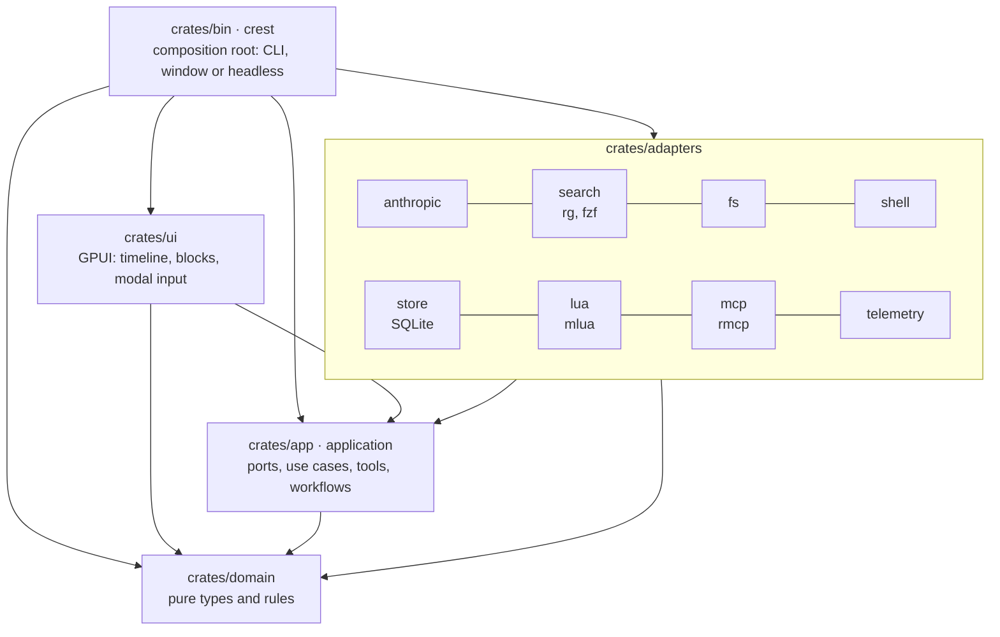

# crest

crest is a coding agent in the style of Claude Code, written in Rust. It opens in a full-screen window that looks like a terminal and works on a directory, the *workspace*: it reads, searches and edits files and runs commands with your approval.

What sets it apart:

- **A timeline with rich blocks.** The agent does not just answer with text. It shows charts (with their table, one `t` keypress away), sortable tables, Mermaid diagrams with pan and zoom, markdown documents, colored diffs and blocks defined by your own plugins.
- **Anthropic models by role.** Every call asks for a role (`main`, `plan`, `explore`, `compact`, `title`, `component`, `deep`), and the configuration decides which model serves it, with its fallbacks.
- **Search with `rg` and `fzf`.** The agent's tools and the window's pickers use the same processes, so you see what the model sees.
- **Config and plugins in Lua**, with Neovim-style modal key bindings (insert, normal and command). From Lua you can add tools, hooks, commands and blocks, all inside a sandbox with instruction and memory limits.
- **Guided workflows.** The *research* workflow (X-Workflow, 14 nodes) goes from a problem to a Spec with its plan. The *implementation* workflow runs that plan task by task, with one commit per task and a final report.
- **Hexagonal architecture.** The domain and the use cases know nothing about GPUI, HTTP, Lua or SQLite, and `make arch` verifies it.

## The screen

There are no screenshots yet. The window has three stacked areas and an optional side panel:

- **Timeline.** Takes up most of the screen. Every reply, tool call, diff or chart is a block, and you move between them with `j`/`k`.
- **Input.** Multi-line, below the timeline. It shows the current mode (`INSERT`, `NORMAL` or `COMMAND`) and the pending keys of a sequence.
- **Status bar.** At the bottom: mode, the turn's model, permission mode (`ask`, `auto-edit`, `plan`), session cost and workspace name. Notices are shown for a few seconds.
- **Workspace tree.** Optional panel on the left (`<Space>e`). On top of all of this appear the file and text pickers, the model menu and the approval dialog with the diff or the exact command.

The theme is dark and the font monospace (JetBrains Mono if installed).

## Requirements

| Component | Version | Notes |
| --- | --- | --- |
| Linux or macOS | — | Windows is out of scope. |
| Rust (rustup, rustfmt, clippy) | stable, ≥ 1.99 | Edition 2024. `rust-toolchain.toml` pins `stable`. |
| C compiler, `pkg-config`, `cmake`, `clang` | — | On macOS, the Xcode Command Line Tools. |
| GPUI libraries on Linux | — | `libxkbcommon`, `libxkbcommon-x11`, `wayland`, `libxcb`, `libx11-xcb`, `fontconfig`, `freetype`. |
| Vulkan on Linux | — | The loader and a GPU driver (GPUI renders with Vulkan). |
| macOS | ≥ 11 | Xcode with the Metal compiler (`make doctor` checks it). |
| `ripgrep` (`rg`) | ≥ 13.0 | The `grep`, `list_files`, `find_file` and `tree` tools. |
| `fzf` | ≥ 0.36 | `find_file` (`--filter --scheme=path`). Without `fzf`, it falls back to substring search. |
| `git` | — | Repo data and workflows. |
| `jq` | — | Only for `scripts/check-arch.sh`. |
| Anthropic API key | — | `ANTHROPIC_API_KEY` or the system keyring (service `crest`, entry `ANTHROPIC_API_KEY`). |

SQLite is compiled into the binary and TLS uses rustls, so neither `libsqlite3` nor OpenSSL is needed.

## Installation

```bash
git clone <repo> crest && cd crest
make deps      # installs what is missing (apt, dnf, yum, pacman, zypper, apk, xbps or Homebrew)
make doctor    # checks without installing anything; exits with 1 if something is missing
make release   # target/release/crest (or `make build` for debug)
make install   # copies the binary to ~/.local/bin (PREFIX=/other/path to change it)
```

`make deps` uses `scripts/install-deps.sh`, which accepts:

- `--check`: only checks;
- `--yes`: does not ask before installing;
- `--dev`: adds `cargo-insta` and `cargo-nextest`;
- `--no-rust`: neither checks nor installs Rust.

If your distro's `rg` or `fzf` is older than the minimum (Ubuntu 22.04's `fzf` is 0.29), the script downloads the official binaries to `~/.local/bin`. `make deps-dev` is the same as `make deps` with `--dev`.

Then set the key:

```bash
export ANTHROPIC_API_KEY=sk-ant-...
```

To store it in the keyring instead of using the variable, see [docs/configuration.md](docs/configuration.md#anthropic-api-key).

## Quick start

```bash
cd ~/src/mi-proyecto
crest                         # or: crest ~/src/mi-proyecto, or make run WORKSPACE=~/src/mi-proyecto
```

1. Type a prompt, for example "what does src/main.rs do?", and press `Enter`. `Shift+Enter` inserts a new line.
2. When the agent wants to edit a file or run a command, the approval dialog appears:
   - `y` approves;
   - `a` always approves (that same file or command);
   - `n` rejects.
3. `Esc` switches to normal mode:
   - `j`/`k` move between blocks;
   - `Enter` expands a tool call;
   - `t` toggles a chart and its table;
   - `<Space>ff` searches files;
   - `<Space>p` changes the permission mode;
   - `:q` quits.
4. When you open crest again in the same directory, the last session is resumed. `crest --new` starts a new one.

Without a window (headless), crest runs one turn and prints it to the terminal, with approvals on stdin:

```bash
crest --headless "find where the config is parsed and explain it" --workspace .
crest --headless "fix the failing test" --mode auto-edit --yes
make run-headless PROMPT="list the TODOs" WORKSPACE=.
```

To research a problem and then implement the fix:

```text
:research the add() tests fail with negative numbers
…answer «sí» at each gate…
:implement 0001-<slug>
```

## Documentation

| Guide | Contents |
| --- | --- |
| [docs/usage.md](docs/usage.md) | Window, modes, every key binding and `:` command, approvals, blocks, the full CLI, headless mode, sessions and MCP. |
| [docs/configuration.md](docs/configuration.md) | Paths, precedence, API key, `app.opt`, models by role, permissions, environment variables, Langfuse and a full `init.lua`. |
| [docs/plugins.md](docs/plugins.md) | How to write Lua plugins: sandbox, the `app` table, tools, hooks, `Custom` blocks, MCP and examples. |
| [docs/workflows.md](docs/workflows.md) | The research workflow (14 nodes, gates, Specs) and the implementation workflow (steps, gates, commits, report). |
| [docs/architecture.md](docs/architecture.md) | Layers, ports and adapters, the loop of a turn, events, threads and persistence. |
| [docs/development.md](docs/development.md) | Tests, fakes and how to add tools, blocks, adapters or nodes; commit conventions and CI. |

## Architecture at a glance



- `domain` depends on no crate of the project, and `application` only on `domain`.
- Each adapter and `ui` depend only on `application` and `domain`. Only `bin` wires them together.
- The use cases talk to the world through ports (`LlmPort`, `FileSystemPort`, `ShellPort`, `ApprovalPort`, `EventSink`...), and every port has a fake in `application::testing`.

The details are in [docs/architecture.md](docs/architecture.md).

## Repository layout

```text
Cargo.toml              workspace, shared dependencies and lints
Makefile                build, test and check targets
rust-toolchain.toml     stable toolchain with rustfmt and clippy
crates/
  domain/               pure types and rules
  app/                  `application`: ports, use cases, tools, workflows, fakes
  adapters/             anthropic, search, fs, shell, store, lua, mcp, telemetry
  ui/                   GPUI views (plus runnable examples/)
  bin/                  the `crest` binary and end-to-end integration tests
scripts/
  install-deps.sh       installs or checks dependencies (Bash 3.2+)
  check-arch.sh         hexagonal architecture rules
  package.sh            builds the release tarball
tests/
  arch/                 fixtures and tests for check-arch.sh
  install-deps/         tests for install-deps.sh
docs/                   user and developer guides
.github/workflows/      ci.yml, live.yml, release.yml
```

## Makefile targets

| Target | What it does |
| --- | --- |
| `make help` | Lists the targets (default). |
| `make deps` / `make deps-dev` | Installs the dependencies (with development tools in the second). |
| `make doctor` | Checks the dependencies without installing. |
| `make build` / `make release` | Builds the workspace (debug) / the optimized `target/release/crest` binary. |
| `make run WORKSPACE=<dir>` | Opens the window on a directory (`.` by default). |
| `make run-headless PROMPT="..." [WORKSPACE=<dir>]` | One turn without a window. |
| `make fmt` / `make fmt-check` | Formats / checks the formatting. |
| `make lint` | Strict Clippy (`-D warnings`). |
| `make test` / `make test-live` | Offline tests / tests against the real API (needs `ANTHROPIC_API_KEY`). |
| `make arch` / `make test-arch` | Architecture rules / their tests. |
| `make test-deps` | Tests for `install-deps.sh`. |
| `make check` | `fmt-check`, `lint`, `test`, `arch`, `test-arch` and `test-deps`. |
| `make ci` | `doctor` + `check`. |
| `make package` | Release tarball in `dist/`. |
| `make install` | Copies the binary to `$(PREFIX)/bin` (`PREFIX=~/.local`). |
| `make clean` | `cargo clean`. |

## Development

```bash
make deps-dev
make check        # what must pass before every commit
make test-live    # optional: tests against the real API
```

- The tests use no network: use cases are tested with the fakes from `application::testing`, the API with `wiremock` and the UI with GPUI's test context.
- Tests against the real API are marked `#[ignore]` and need `ANTHROPIC_LIVE_TEST=1` (set by `make test-live`) and `ANTHROPIC_API_KEY`.
- CI (`.github/workflows/ci.yml`) runs `make ci` on Ubuntu 24.04 and macOS 15. `live.yml` runs `make test-live` manually, and `release.yml` publishes tarballs for Linux x86_64 and macOS (arm64 and x86_64) on every `v*` tag.

The conventions and extension points are in [docs/development.md](docs/development.md).

## Project status and known limitations

All 11 phases of the original plan are implemented and `make check` passes on Linux. Before relying on crest for real work, keep in mind what has not been tested and what is still missing:

**Unverified**

- It has not been tested against the real Anthropic API in the development environment: every test uses scripted models or `wiremock`, and `make test-live` has not been run here. The default model ids (`claude-sonnet-5-5`, `claude-opus-5-5`, `claude-haiku-5-5`, `claude-fable-5-1`) are validated against `GET /v1/models` at startup.
- macOS has not been tested on a real machine. The code and the CI account for it, but nothing has been run there.
- CI has never run on GitHub: the repository has no remote configured.
- Reading the API key from the system keyring has not been tested.

**Behavior to keep in mind**

- `Ctrl+C` does not interrupt a running workflow (`:research`, `:implement`). In the window it does not reach the running step, and in headless mode it kills the process. To stop a workflow in an orderly way, use `/abort` at a gate. It does interrupt normal turns, in the window and in headless mode.
- At workflow gates, an empty line counts as «sí / continuar». In the implementation workflow that can commit with failing criteria or close the workflow.
- In the implementation workflow, only `edit_file` and `write_file` are restricted to the task's files: `run_command` can touch others (although the commit only includes the task's files).
- crest ships no model prices: until you set `app.opt.pricing`, the cost shows as `$?`. The cost lives in memory, so a resumed session starts again at `$0.00` against the cap.

**Not available yet**

- `app.opt.theme` is read but has no effect: there is no light theme and no configurable font.
- `app.opt.leader` only affects mappings defined in Lua; the builtin ones always use space. Actions such as `session.resume` are not implemented.
- There is no command to list or pick older sessions: the workspace's last one is always resumed.
- Compaction assumes a 200,000-token context window, whatever the model, and its threshold is not configurable.
- `:mcp trust` takes effect the next time you open crest; `--trust-mcp` starts the server in the same run.
- Langfuse export requires building with `--features langfuse`; the `make release` binaries do not include it.
- The macOS binaries from `release.yml` are not signed or notarized.
- Some messages (errors from the research workflow's `/` commands, `init.lua` diagnostics) are in English and the rest in Spanish.
