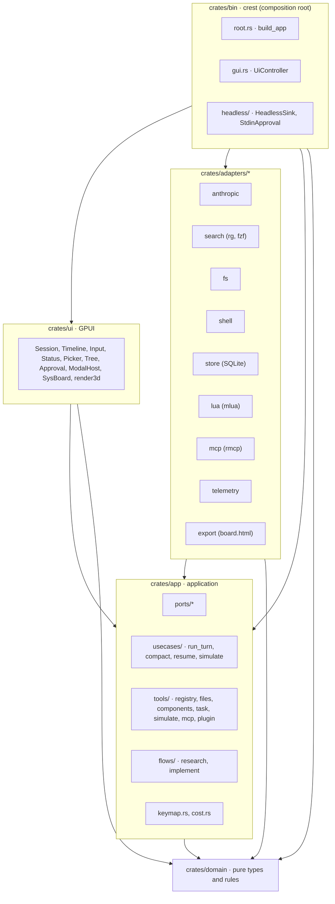
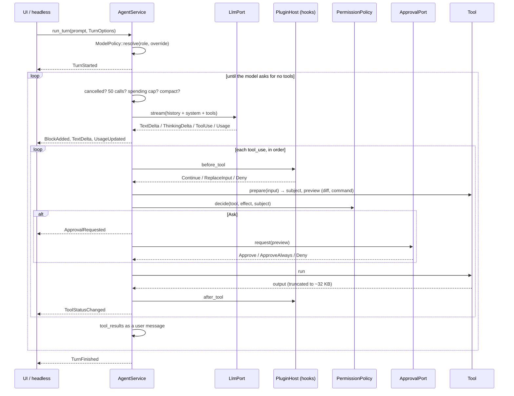
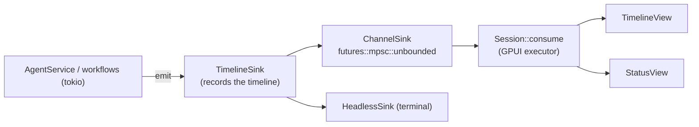
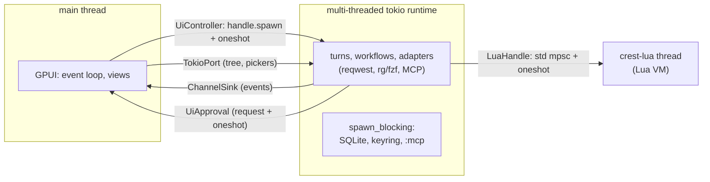

# Architecture

crest follows a hexagonal architecture (ports and adapters):

- The domain and the use cases know nothing about GPUI, HTTP, Lua, SQLite or external processes.
- All of that lives in adapters that implement traits (**ports**) defined in `application`.
- The binary is the only place that wires all the pieces together.

## Layers and crates

| Crate (package) | Path | Contents |
| --- | --- | --- |
| `domain` | `crates/domain` | Pure types and rules: the conversation (`Session`, `Turn`, `Message`), `Block` and its payloads, `ModelPolicy` and roles, `PermissionPolicy`, `WorkspacePath` and sensitive paths, research types (`Evidence`, `Hypothesis`, `Constraint`, `Decision`), the `plan.json` schema and `sysmodel` (the `crest.sysmodel/v1` model, its expression language, lint, the deterministic simulator, traces, the assertion checker, the board layout and its renderer-agnostic 3D scene). No tokio, no I/O. |
| `application` | `crates/app` | Ports (async traits), use cases (`AgentService::run_turn`, compaction, resume), the tool registry and the tool definitions, the keymap parser, cost, the graph-flow workflows and the fakes (`testing`, behind the `testing` feature). |
| `adapter-anthropic` | `crates/adapters/anthropic` | Messages API with SSE streaming, retries and model fallback, the `GET /v1/models` catalog and server tools (web search and fetch). |
| `adapter-search` | `crates/adapters/search` | `rg --files`, `rg --json` and `fzf --filter` as processes without a shell. Includes version detection. |
| `adapter-fs` | `crates/adapters/fs` | Reading and writing through `WorkspaceGuard` (canonicalization and sensitive paths) and diffs with `similar`. |
| `adapter-shell` | `crates/adapters/shell` | `tokio::process` with a timeout, `cwd` in the workspace and capped output. |
| `adapter-web` | `crates/adapters/web` | `WebPort` over `curl` (no shell, minimal environment, headers on stdin): DuckDuckGo HTML, SearXNG or Brave search, and pages to text with `html2text`. |
| `adapter-store` | `crates/adapters/store` | SQLite (embedded `rusqlite`): sessions and graph-flow's `SessionStorage`. |
| `adapter-lua` | `crates/adapters/lua` | `mlua` host (Lua 5.4) on its own thread, with the sandbox, config loading and merging, and the `app` API. |
| `adapter-mcp` | `crates/adapters/mcp` | `rmcp` client (stdio and streamable HTTP). |
| `adapter-export` | `crates/adapters/export` | `SimExport`: the self-contained `board.html` replay of a simulated board, with three.js r160 vendored in `vendor/three/` (MIT) and inlined. |
| `adapter-telemetry` | `crates/adapters/telemetry` | `tracing` spans and, with the `langfuse` feature, OTLP export to Langfuse. |
| `ui` | `crates/ui` | The GPUI window and `gpui-component`: virtualized timeline, blocks, modal input, status bar, tree, pickers, approval dialog, plugin modals, the simulation board (`sysboard/`) and its offscreen wgpu renderer (`render3d/`). |
| `crest` | `crates/bin` | Composition root: CLI, adapter construction, window or headless. |

## Ports and adapters

| Port | File | Methods | Real adapter | Fake (`application::testing`) |
| --- | --- | --- | --- | --- |
| `LlmPort` | `ports/llm.rs` | `stream(LlmRequest)`, `count_tokens` | `adapter_anthropic::AnthropicLlm`. In the research workflow it is wrapped by `WebToolsLlm` (bin). | `llm::ScriptedLlm` |
| `ModelCatalogPort` | `ports/llm.rs` | `list_models()` | `adapter_anthropic::AnthropicCatalog` | `llm::FakeModelCatalog` |
| `McpPort` | `ports/mcp.rs` | `list_tools`, `call_tool`, `servers` | `adapter_mcp::McpManager` (with the bin's `TimedMcp`, for per-server timeouts) | `llm::FakeMcp` |
| `FileSystemPort` | `ports/fs.rs` | `root`, `read_file`, `exists`, `prepare_edit`, `prepare_write`, `apply` | `adapter_fs::LocalFs` | `fs::InMemoryFs` |
| `FileSearchPort` | `ports/search.rs` | `list_files`, `find_file`, `tree` | `adapter_search::RipgrepSearch` | `fs::InMemoryFs` |
| `ContentSearchPort` | `ports/search.rs` | `grep` | `adapter_search::RipgrepSearch` | `fs::InMemoryFs` |
| `ShellPort` | `ports/shell.rs` | `run`, `classify` | `adapter_shell::LocalShell` | `fs::ScriptedShell` |
| `ApprovalPort` | `ports/approval.rs` | `request(ApprovalRequest)` | `ui::approval::UiApproval` (window), `crest::headless::StdinApproval` (terminal) | `system::ScriptedApproval` |
| `EventSink` | `ports/events.rs` | `emit(DomainEvent)` | `crest::gui::ChannelSink`, `crest::headless::HeadlessSink`. Both are wrapped in a `TimelineSink` (bin), which records the timeline that gets saved. | `system::RecordingSink` |
| `SessionStorePort` | `ports/store.rs` | `save`, `load`, `latest_for_workspace`, `list`, `delete` | `adapter_store::SqliteSessionStore` | `system::InMemorySessionStore` |
| `PluginHostPort` | `ports/plugin.rs` | `load_config`, `invoke_callback`, `call_tool`, `run_hook` | `adapter_lua::LuaHandle` | `system::FakePluginHost` |
| `SimExport` | `ports/sim.rs` | `board_html(&Board)` | `adapter_export::HtmlExporter` | — (the use case tests use a stub) |
| `TelemetryPort` | `ports/telemetry.rs` | `turn_started`, `llm_call`, `tool_call`, `turn_finished` | `adapter_telemetry::TracingTelemetry` (and `NoopTelemetry` in the port itself) | `system::RecordingTelemetry` |
| `SessionStorage` (graph-flow trait) | — | — | `adapter_store::SqliteFlowStorage` | graph-flow's in-memory storage |

The UI also defines its own inbound port, `ui::session::SessionController`, with the methods `run_turn`, `permission_mode`, `models`, `new_session`, `run_callback` and `run_command`. The binary implements it (`UiController`) on top of the real `AgentService`. The UI depends only on `application` and `domain`.

## A turn: `run_turn`

`AgentService::run_turn` (`crates/app/src/usecases/run_turn.rs`) is the agent loop:

Each iteration of the loop goes through these steps:

1. **Pre-checks**, in this order:
   - cancellation;
   - the limit of 50 model calls per turn (exceeding it gives `TooManyIterations`);
   - spending cap: if it has been reached, asks through the `ApprovalPort` with the `spend_cap` tool;
   - compaction: if the estimated context exceeds 0.8 × 200,000 tokens, summarizes the old turns with the `compact` role and keeps the last 2.
2. **Request**:
   - the session history plus the turn's messages;
   - the system prompt, marked for prompt caching;
   - the tool definitions, sorted by name, with the last one marked for caching.
3. **Streaming**:
   - text and thinking open blocks and emit deltas;
   - each `tool_use` opens a `ToolCall` block;
   - `Retrying` and `ModelFallback` are forwarded to the UI;
   - `usage` updates the cost and the context estimate.

   If the API replies that the context is too long, the loop compacts and retries once.
4. **No tools**: if the model asked for no tools, the turn ends with its `stop_reason`.
5. **Tools**, one at a time and in order. For each one:
   1. the `before_tool` hook;
   2. `effect`;
   3. `prepare`, which returns the subject and the preview;
   4. the permission policy: `Allow`, `Ask` (which goes through `ApprovalPort`) or `Deny`;
   5. execution;
   6. the output budget;
   7. the `after_tool` hook.

   Denials are returned to the model as a `tool_result` with an error.
6. **Cancellation**: the `CancelToken` races against the stream and against each tool. On cancellation, the running call and the pending ones get "cancelled by user" and the turn ends as `Interrupted`, with the session left consistent.

The permission policy (`domain::permission`) combines the mode (`ask`, `auto-edit`, `plan`) with the tool's effect (`read`, `write`, `execute`, `network`) and with the user's rules:

- a `Deny` rule always wins;
- `AllowAlways` turns an `Ask` into `Allow`;
- the subagents' `read_only()` policy denies everything that is not a read.

## Domain events to the UI

The use cases draw nothing: they emit `DomainEvent` (`ports/events.rs`) through the `EventSink`.

| Event | Meaning |
| --- | --- |
| `TurnStarted { model, role, … }` | A turn started with this model. |
| `BlockAdded { block }` / `BlockUpdated { block }` | New block / replacement of the block with the same id. |
| `TextDelta` / `ThinkingDelta { block_id, text }` | Streaming text or thinking. |
| `ToolStatusChanged { block_id, status, output }` | A ToolCall changed status. |
| `ApprovalRequested { request_id, block_id }` | A call is waiting for approval. |
| `UsageUpdated { turn, session, cost_usd }` | Tokens and cost. |
| `ModelFallback { from, to }`, `Retrying { attempt, delay_ms }` | Retries and model changes. |
| `ModeChanged { mode }` | Permission mode (the window emits it when it changes). |
| `TurnFinished { stop_reason }` / `TurnFailed { error }` | End of the turn. |
| `Notice { level, message }` | Notice for the status bar. |
| `ModalOpened { spec }` / `ModalUpdated { id, content }` / `ModalClosed { id }` | A plugin modal (`app.modal.*`), pushed by the Lua host. |
| `SimulationReady { board }` | A simulated Spec (`:simulate`, `simulate_solution`): the window opens its board in a full-size modal. Like the modal events, it is not saved with the timeline. |

In the window, a single GPUI task consumes the channel. It batches the events already queued and applies them in order to `TimelineState`, which is a pure model tested without a window, and to the status bar. `TimelineSink` applies the same events to another `TimelineState`, which is the one saved with the session.

The Lua host has the front end's sink too (`HostOptions::events`), so `app.modal.*` emit modal events directly from the `crest-lua` thread; they skip `TimelineSink` (modals are not saved) and the session hands them to the `ModalHost` overlay. Before any sink sees them, `ImageGuardSink` (`crates/bin/src/images.rs`) checks every image path in modals and `Custom` blocks with the workspace guard (inside the workspace, not sensitive) and replaces rejected images with a text node. `modal_bounds` (`domain::modal`) is the pure geometry rule the overlay draws with.

## Threads

- `main.rs` creates a multi-threaded tokio runtime. GPUI runs its own executor on the main thread (`gui::run`).
- `build_app` runs with `handle.block_on` before the window opens.
- Each turn, each workflow line and each command (`:implement`, `:research`, Lua commands) is launched on tokio with `handle.spawn`. GPUI awaits a `oneshot` and never runs tokio futures.
- Tree and picker searches go through `TokioPort`, which runs them on the runtime.
- Approvals travel through a channel to the dialog, and each request carries its own response `oneshot`. If the turn stops waiting (for example, because you cancelled it), the dialog closes.
- The Lua VM lives on its own `std::thread` (`crest-lua`) and serves requests one at a time. `LuaHandle` sends closures and awaits the result without blocking the runtime.
- SQLite and the keyring run in `spawn_blocking`.
- Headless mode uses `runtime.block_on` on the use case, without GPUI.

## Persistence

The database is a single SQLite file: `$XDG_DATA_HOME/crest/sessions.db` (by default `~/.local/share/crest/sessions.db`). It uses WAL and a 5 s `busy_timeout`, and its migrations are embedded and versioned with `PRAGMA user_version`.

| Migration | Tables | What they store |
| --- | --- | --- |
| `0001_init.sql` | `sessions`, `timeline_blocks`, `permission_rules` | The session (history as JSON), its timeline block by block and its "always allow" rules. |
| `0002_turn_count.sql` | `sessions.turn_count` | Number of turns (to list without deserializing). |
| `0003_flow_sessions.sql` | `flow_sessions` | graph-flow checkpoints of both workflows, with optimistic locking by version. |

- The session is saved after every turn, as `StoredSession { session, timeline, permission_rules }`.
- On startup, `resume_latest` takes the workspace's most recent session (by canonical path), restores its rules and re-emits its timeline.
- Outside SQLite live `mcp-trust.json` (approved MCP servers) and the Specs (`<workspace>/.crest/specs/`).

## Composition root

`crates/bin/src/root.rs::build_app` builds everything:

1. `WorkspaceGuard::open`: canonicalizes the workspace (if it fails, the error is fatal).
2. Starts `LuaHost` and loads the config. Errors become `Error` blocks and crest carries on with the defaults.
3. Sensitive paths, `RipgrepSearch` and the `rg` and `fzf` checks.
4. API key, `AnthropicLlm` and catalog validation (5 s at most).
5. `SqliteSessionStore`.
6. `ToolRegistry`: file tools, component tools, `task`, `simulate_solution` (over the `Simulator`, which `:simulate` and `--simulate` share), plugin tools and MCP tools (with trust-based admission).
7. Session resume, `AgentService` with compaction, hooks and `CostTracker`.
8. `SqliteFlowStorage`, `ResearchSession` and `ImplementDeps`.

Every non-essential step degrades to a notice: without Lua, without a database or without the catalog, crest starts anyway. Only the workspace and the API key are fatal. In the window, not even a missing API key prevents it from opening: `UnavailableController` answers every prompt with the error.

## Dependency rules

| Layer | May depend on | Forbidden |
| --- | --- | --- |
| `domain` | no crate of the project | I/O crates |
| `application` (must be named so) | `domain` | I/O crates, adapters, `ui` |
| adapters | `application`, `domain` | other adapters, `ui` |
| `ui` | `application`, `domain` | adapters |
| `bin` | everything | — |

The I/O crates that `domain` and `application` cannot use (in normal and build dependencies) are:

`tokio`, `reqwest`, `reqwest-eventsource`, `hyper`, `gpui`, `gpui-component`, `mlua`, `rusqlite`, `sqlx`, `rmcp`, `notify`, `keyring`, `opentelemetry*` and `tracing-opentelemetry`.

`application` uses `tokio` only in its dev-dependencies (for the tests).

`scripts/check-arch.sh` (`make arch`) enforces these rules:

- It reads `cargo metadata --no-deps --offline` with `jq`.
- It classifies each crate by its manifest path. A path that fits no layer is an error.
- It checks internal dependencies, including dev and build ones.
- It requires the `crates/app` package to be named `application`.
- It exits with 0 if all is well, 1 if there are violations and 2 on misuse.
- It works with Bash 3.2. `make test-arch` tests it against the workspaces in `tests/arch/fixtures/`.
