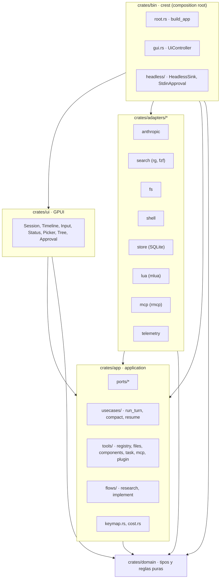
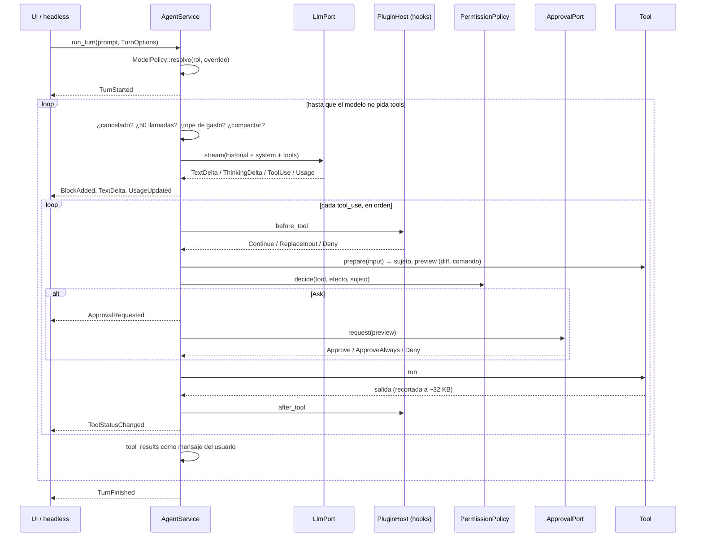
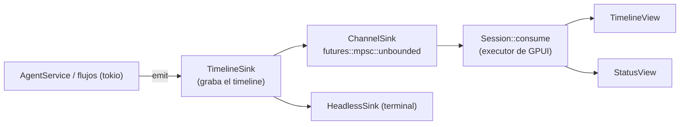
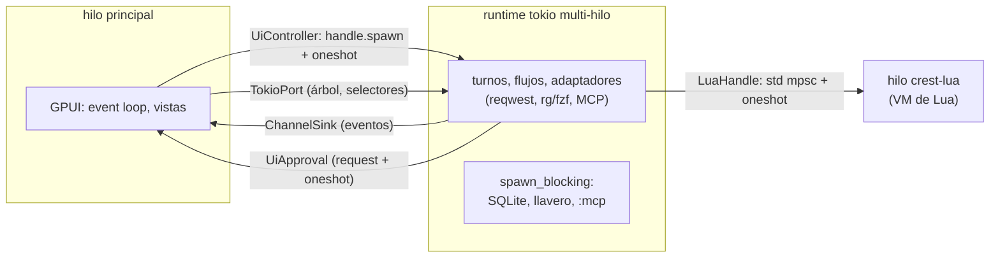

# Arquitectura

crest sigue una arquitectura hexagonal (puertos y adaptadores):

- El dominio y los casos de uso no conocen GPUI, HTTP, Lua, SQLite ni procesos externos.
- Todo eso vive en adaptadores que implementan traits (**puertos**) definidos en `application`.
- El binario es el único lugar que conecta todas las piezas.

## Capas y crates

| Crate (paquete) | Ruta | Contenido |
| --- | --- | --- |
| `domain` | `crates/domain` | Tipos y reglas puras: conversación (`Session`, `Turn`, `Message`), `Block` y sus payloads, `ModelPolicy` y roles, `PermissionPolicy`, `WorkspacePath` y rutas sensibles, tipos de investigación (`Evidence`, `Hypothesis`, `Constraint`, `Decision`) y el schema de `plan.json`. Sin tokio ni I/O. |
| `application` | `crates/app` | Puertos (traits async), casos de uso (`AgentService::run_turn`, compactación, reanudación), el registro de tools y sus definiciones, el parser de keymaps, el costo, los flujos de graph-flow y los fakes (`testing`, detrás de la feature `testing`). |
| `adapter-anthropic` | `crates/adapters/anthropic` | Messages API con streaming SSE, reintentos y fallback de modelo, catálogo `GET /v1/models` y tools de servidor (web search y fetch). |
| `adapter-search` | `crates/adapters/search` | `rg --files`, `rg --json` y `fzf --filter` como procesos sin shell. Incluye la detección de versiones. |
| `adapter-fs` | `crates/adapters/fs` | Lectura y escritura con `WorkspaceGuard` (canonicalización y rutas sensibles) y diffs con `similar`. |
| `adapter-shell` | `crates/adapters/shell` | `tokio::process` con timeout, `cwd` en el workspace y salida limitada. |
| `adapter-store` | `crates/adapters/store` | SQLite (`rusqlite` embebido): sesiones y `SessionStorage` de graph-flow. |
| `adapter-lua` | `crates/adapters/lua` | Host `mlua` (Lua 5.4) en su hilo, con sandbox, carga y merge de config y la API `app`. |
| `adapter-mcp` | `crates/adapters/mcp` | Cliente `rmcp` (stdio y streamable HTTP). |
| `adapter-telemetry` | `crates/adapters/telemetry` | Spans de `tracing` y, con la feature `langfuse`, exportación OTLP a Langfuse. |
| `ui` | `crates/ui` | La ventana GPUI y `gpui-component`: timeline virtualizado, bloques, input modal, barra de estado, árbol, selectores y diálogo de aprobación. |
| `crest` | `crates/bin` | Composition root: CLI, construcción de adaptadores, ventana o headless. |

## Puertos y adaptadores

| Puerto | Archivo | Métodos | Adaptador real | Fake (`application::testing`) |
| --- | --- | --- | --- | --- |
| `LlmPort` | `ports/llm.rs` | `stream(LlmRequest)`, `count_tokens` | `adapter_anthropic::AnthropicLlm`. En el flujo investigativo lo envuelve `WebToolsLlm` (bin). | `llm::ScriptedLlm` |
| `ModelCatalogPort` | `ports/llm.rs` | `list_models()` | `adapter_anthropic::AnthropicCatalog` | `llm::FakeModelCatalog` |
| `McpPort` | `ports/mcp.rs` | `list_tools`, `call_tool`, `servers` | `adapter_mcp::McpManager` (con `TimedMcp` del bin, para los timeouts por servidor) | `llm::FakeMcp` |
| `FileSystemPort` | `ports/fs.rs` | `root`, `read_file`, `exists`, `prepare_edit`, `prepare_write`, `apply` | `adapter_fs::LocalFs` | `fs::InMemoryFs` |
| `FileSearchPort` | `ports/search.rs` | `list_files`, `find_file`, `tree` | `adapter_search::RipgrepSearch` | `fs::InMemoryFs` |
| `ContentSearchPort` | `ports/search.rs` | `grep` | `adapter_search::RipgrepSearch` | `fs::InMemoryFs` |
| `ShellPort` | `ports/shell.rs` | `run`, `classify` | `adapter_shell::LocalShell` | `fs::ScriptedShell` |
| `ApprovalPort` | `ports/approval.rs` | `request(ApprovalRequest)` | `ui::approval::UiApproval` (ventana), `crest::headless::StdinApproval` (terminal) | `system::ScriptedApproval` |
| `EventSink` | `ports/events.rs` | `emit(DomainEvent)` | `crest::gui::ChannelSink`, `crest::headless::HeadlessSink`. Ambos van envueltos en un `TimelineSink` (bin), que graba el timeline que se guarda. | `system::RecordingSink` |
| `SessionStorePort` | `ports/store.rs` | `save`, `load`, `latest_for_workspace`, `list`, `delete` | `adapter_store::SqliteSessionStore` | `system::InMemorySessionStore` |
| `PluginHostPort` | `ports/plugin.rs` | `load_config`, `invoke_callback`, `call_tool`, `run_hook` | `adapter_lua::LuaHandle` | `system::FakePluginHost` |
| `TelemetryPort` | `ports/telemetry.rs` | `turn_started`, `llm_call`, `tool_call`, `turn_finished` | `adapter_telemetry::TracingTelemetry` (y `NoopTelemetry` en el propio puerto) | `system::RecordingTelemetry` |
| `SessionStorage` (trait de graph-flow) | — | — | `adapter_store::SqliteFlowStorage` | almacenamiento en memoria de graph-flow |

La UI también define su propio puerto de entrada, `ui::session::SessionController`, con los métodos `run_turn`, `permission_mode`, `models`, `new_session`, `run_callback` y `run_command`. Lo implementa el binario (`UiController`) sobre el `AgentService` real. La UI solo depende de `application` y `domain`.

## Un turno: `run_turn`

`AgentService::run_turn` (`crates/app/src/usecases/run_turn.rs`) es el loop del agente:

Cada iteración del loop sigue estos pasos:

1. **Comprobaciones previas**, en este orden:
   - cancelación;
   - límite de 50 llamadas al modelo por turno (si se supera, `TooManyIterations`);
   - tope de gasto: si se alcanzó, pregunta por el `ApprovalPort` con la tool `spend_cap`;
   - compactación: si el contexto estimado pasa de 0,8 × 200 000 tokens, resume los turnos viejos con el rol `compact` y conserva los 2 últimos.
2. **Petición**:
   - el historial de la sesión más los mensajes del turno;
   - el system prompt, marcado para prompt caching;
   - las definiciones de tools, ordenadas por nombre y con la última marcada para caché.
3. **Streaming**:
   - el texto y el razonamiento abren bloques y emiten deltas;
   - cada `tool_use` abre un bloque `ToolCall`;
   - `Retrying` y `ModelFallback` se reenvían a la UI;
   - el `usage` actualiza el costo y la estimación de contexto.

   Si la API responde que el contexto es demasiado largo, el loop compacta y reintenta una vez.
4. **Sin tools**: si el modelo no pidió tools, el turno termina con su `stop_reason`.
5. **Tools**, de una en una y en orden. Para cada una:
   1. hook `before_tool`;
   2. `effect`;
   3. `prepare`, que devuelve el sujeto y la vista previa;
   4. política de permisos: `Allow`, `Ask` (que pasa por `ApprovalPort`) o `Deny`;
   5. ejecución;
   6. presupuesto de salida;
   7. hook `after_tool`.

   Las negaciones se devuelven al modelo como `tool_result` con error.
6. **Cancelación**: el `CancelToken` hace carrera contra el stream y contra cada tool. Al cancelar, la llamada en curso y las pendientes reciben «cancelled by user» y el turno termina como `Interrupted`, con la sesión consistente.

La política de permisos (`domain::permission`) combina el modo (`ask`, `auto-edit`, `plan`) con el efecto de la tool (`read`, `write`, `execute`, `network`) y con las reglas del usuario:

- una regla `Deny` gana siempre;
- `AllowAlways` convierte un `Ask` en `Allow`;
- la política `read_only()` de los subagentes niega todo lo que no sea lectura.

## Eventos de dominio hacia la UI

Los casos de uso no dibujan nada: emiten `DomainEvent` (`ports/events.rs`) por el `EventSink`.

| Evento | Significado |
| --- | --- |
| `TurnStarted { model, role, … }` | Empezó un turno con este modelo. |
| `BlockAdded { block }` / `BlockUpdated { block }` | Bloque nuevo / reemplazo del bloque con el mismo id. |
| `TextDelta` / `ThinkingDelta { block_id, text }` | Streaming de texto o de razonamiento. |
| `ToolStatusChanged { block_id, status, output }` | Cambio de estado de un ToolCall. |
| `ApprovalRequested { request_id, block_id }` | Una llamada espera aprobación. |
| `UsageUpdated { turn, session, cost_usd }` | Tokens y costo. |
| `ModelFallback { from, to }`, `Retrying { attempt, delay_ms }` | Reintentos y cambio de modelo. |
| `ModeChanged { mode }` | Modo de permisos (la ventana lo emite al cambiarlo). |
| `TurnFinished { stop_reason }` / `TurnFailed { error }` | Fin del turno. |
| `Notice { level, message }` | Aviso para la barra de estado. |

En la ventana, una única tarea de GPUI consume el canal. Junta los eventos que ya están en cola y los aplica en orden a `TimelineState`, que es un modelo puro y se prueba sin ventana, y a la barra de estado. `TimelineSink` aplica los mismos eventos a otro `TimelineState`, que es el que se guarda con la sesión.

## Hilos

- `main.rs` crea un runtime tokio multi-hilo. GPUI corre su propio executor en el hilo principal (`gui::run`).
- `build_app` se ejecuta con `handle.block_on` antes de abrir la ventana.
- Cada turno, cada línea de un flujo y cada comando (`:implement`, `:research`, comandos Lua) se lanzan en tokio con `handle.spawn`. GPUI espera un `oneshot` y nunca ejecuta futures de tokio.
- Las búsquedas del árbol y de los selectores pasan por `TokioPort`, que las ejecuta en el runtime.
- Las aprobaciones viajan por un canal hacia el diálogo, y cada solicitud lleva su `oneshot` de respuesta. Si el turno abandona la espera (por ejemplo, porque lo cancelaste), el diálogo se cierra.
- La VM de Lua vive en su propio `std::thread` (`crest-lua`) y atiende las peticiones de una en una. `LuaHandle` envía closures y espera el resultado sin bloquear el runtime.
- SQLite y el llavero corren en `spawn_blocking`.
- Headless usa `runtime.block_on` sobre el caso de uso, sin GPUI.

## Persistencia

La base es un único archivo SQLite: `$XDG_DATA_HOME/crest/sessions.db` (por defecto `~/.local/share/crest/sessions.db`). Usa WAL y `busy_timeout` de 5 s, y sus migraciones están embebidas y versionadas con `PRAGMA user_version`.

| Migración | Tablas | Qué guardan |
| --- | --- | --- |
| `0001_init.sql` | `sessions`, `timeline_blocks`, `permission_rules` | La sesión (historial en JSON), su timeline bloque a bloque y sus reglas «permitir siempre». |
| `0002_turn_count.sql` | `sessions.turn_count` | Número de turnos (para listar sin deserializar). |
| `0003_flow_sessions.sql` | `flow_sessions` | Checkpoints de graph-flow de ambos flujos, con bloqueo optimista por versión. |

- La sesión se guarda después de cada turno, como `StoredSession { session, timeline, permission_rules }`.
- Al abrir, `resume_latest` toma la sesión más reciente del workspace (por la ruta canónica), restaura sus reglas y vuelve a emitir su timeline.
- Fuera de SQLite están `mcp-trust.json` (servidores MCP aprobados) y los Specs (`<workspace>/.crest/specs/`).

## Composition root

`crates/bin/src/root.rs::build_app` construye todo:

1. `WorkspaceGuard::open`: canonicaliza el workspace (si falla, el error es fatal).
2. Arranca `LuaHost` y carga la config. Los errores se convierten en bloques `Error` y crest sigue con los valores por defecto.
3. Rutas sensibles, `RipgrepSearch` y verificación de `rg` y `fzf`.
4. API key, `AnthropicLlm` y validación del catálogo (5 s como máximo).
5. `SqliteSessionStore`.
6. `ToolRegistry`: tools de archivos, tools de componentes, `task`, tools de plugins y tools MCP (con la admisión por confianza).
7. Reanudación de la sesión, `AgentService` con compactación, hooks y `CostTracker`.
8. `SqliteFlowStorage`, `ResearchSession` e `ImplementDeps`.

Cada paso que no es esencial degrada a un aviso: sin Lua, sin base de datos o sin catálogo, crest arranca igual. Solo el workspace y la API key son fatales. En la ventana, ni siquiera la falta de API key impide abrirla: `UnavailableController` responde a cada prompt con el error.

## Reglas de dependencia

| Capa | Puede depender de | Prohibido |
| --- | --- | --- |
| `domain` | ningún crate del proyecto | crates de I/O |
| `application` (debe llamarse así) | `domain` | crates de I/O, adaptadores, `ui` |
| adaptadores | `application`, `domain` | otros adaptadores, `ui` |
| `ui` | `application`, `domain` | adaptadores |
| `bin` | todo | — |

Los crates de I/O que no pueden usar `domain` ni `application` (en dependencias normales y de build) son:

`tokio`, `reqwest`, `reqwest-eventsource`, `hyper`, `gpui`, `gpui-component`, `mlua`, `rusqlite`, `sqlx`, `rmcp`, `notify`, `keyring`, `opentelemetry*` y `tracing-opentelemetry`.

`application` usa `tokio` solo en las dev-dependencies (para los tests).

`scripts/check-arch.sh` (`make arch`) hace cumplir estas reglas:

- Lee `cargo metadata --no-deps --offline` con `jq`.
- Clasifica cada crate por la ruta de su manifiesto. Una ruta que no encaja en ninguna capa es un error.
- Revisa las dependencias internas, incluidas las de dev y build.
- Exige que el paquete de `crates/app` se llame `application`.
- Sale con 0 si todo está bien, con 1 si hay violaciones y con 2 si se usó mal.
- Funciona con Bash 3.2. `make test-arch` lo prueba contra los workspaces de `tests/arch/fixtures/`.
