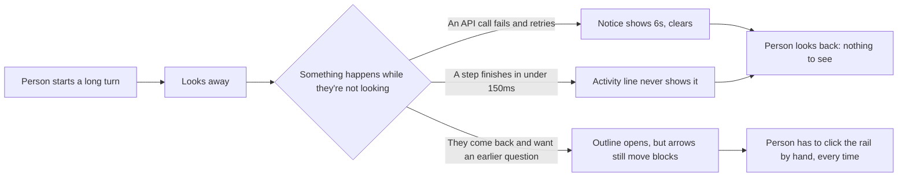

# R01 — Visibility and reach: what a person needs to see and steer in crest

| | |
|---|---|
| **Status** | Proposed. Nothing in it is implemented; the technical plan is [0001-visibility-and-reach.md](../specs/0001-visibility-and-reach.md). |
| **Author** | AI (Cursor), from a Specky3 discovery |
| **Approver** | The crest maintainers |
| **Date** | 2026-11-01 |
| **Source** | Discovery `CREST-UX`, "Weaknesses of the crest UI against the standards for agentic interfaces" |

crest runs a coding agent in a native window: a timeline of what it did, a line that shows what it is doing right now, a status bar, and the questions the person asked along the way. Three moments in that window lose information the person needs. This document is the use cases and the requirements for fixing them, in terms a reader does not need crest's source to follow. The technical plan, with file names and line numbers, is [0001-visibility-and-reach.md](../specs/0001-visibility-and-reach.md).

## Terms

- **Shared control**: seeing what the agent did, interrupting it, redirecting it, or undoing a step, from the window alone.
- **Notice**: a one-line message the status bar shows for a few seconds, then clears.
- **Activity line**: the line above the prompt that shows while the agent works.
- **Step**: one thing the agent did inside a turn, long enough or not to reach the activity line.
- **Outline**: the list of the person's own questions, opened from a mark on the timeline's edge.

## Context: who runs into this

A scientist or engineer runs crest on a long task and looks away, or works in another window, while it runs.



## Use cases

```mermaid
usecase-beta
  direction LR
  actor Person("Scientist or engineer")
  systemBoundary crest["crest window"]
    UC01("UC-01 Read a notice after it leaves the status bar")
    UC02("UC-02 See a step too quick for the activity line")
    UC03("UC-03 Move between own questions with arrow keys")
    UC04("UC-04 Dismiss a kept notice")
    UC05("UC-05 Return arrow keys to the timeline")
  end
  Person --> UC01
  Person --> UC02
  Person --> UC03
  Person --> UC04
  Person --> UC05
  UC01 ..> : include UC04
  UC03 ..> : extend UC05
```

| ID | Use case | Today |
|---|---|---|
| UC-01 | Read a notice after it leaves the status bar | Not possible; the notice is gone once the bar clears. |
| UC-02 | See a step too quick for the activity line | Not possible; a step under the line's delay leaves no trace anywhere. |
| UC-03 | Move between own questions with arrow keys | Not possible; the arrows always move timeline blocks, even with the outline open. Only a mouse click on the rail picks a question. |
| UC-04 | Dismiss a kept notice | New: a notice kept past the status bar has to be dismissed on purpose, so it does not pile up forever. |
| UC-05 | Return arrow keys to the timeline | Already works today (`Esc` closes the outline); restated here because UC-03 must not break it. |

## Functional requirements

- **FR-1** (UC-01, UC-04): An error or warning notice stays reachable after it clears from the status bar, in a place the person opens on their own time, until they dismiss it.
- **FR-2** (UC-01): A dismissed or not-yet-dismissed notice is shown once as a brief preview when it is added, so a person watching the window still catches it without opening anything.
- **FR-3** (UC-02): Every finished step is recorded somewhere the person can review, including one that finished before the activity line's display delay would have shown it.
- **FR-4** (UC-03): While the outline is open, `Up`/`Down` move the outline's own selection among the person's questions, not the timeline's blocks.
- **FR-5** (UC-05): Closing the outline (`Esc`, as today) returns `Up`/`Down` to moving timeline blocks, unchanged from today's behavior.
- **FR-6** (UC-04): The person can dismiss one kept notice individually, without clearing the others.

## Non-functional requirements

- **NFR-1 (timing, unchanged):** The status bar keeps clearing a transient notice after the same delay it uses today. FR-1 does not lengthen it.
- **NFR-2 (timing, unchanged):** The activity line keeps the same delay before it draws anything. FR-3 does not remove it or make a quick step flicker the line.
- **NFR-3 (no regression):** With the outline closed, `Up`/`Down` behave exactly as they do today. FR-4 only applies while the outline is open.
- **NFR-4 (scope):** Nothing here touches crest's command line, headless mode, or the fixed width of the chats and file-tree panels.
- **NFR-5 (evidence):** Every claim about current behavior traces to a measured file and line in crest's source, recorded in the discovery this document comes from, not to memory or guesswork.
- **NFR-6 (no telemetry):** Meeting these requirements adds no tracking of how a person uses crest; none of the three use cases needed it to be found.

## What this does not cover

- The chats list and the file tree keep their fixed width; that is a separate, later improvement found in the same investigation.
- No change to the command line or headless mode.
- No study of how scientists and engineers use crest day to day; the use cases above come from reading the window's own code and design literature on agentic interfaces, not from watching real sessions.
- crest's source is not touched by this document. A working prototype of UC-01 through UC-05 exists outside crest, in a browser mock; [0001-visibility-and-reach.md](../specs/0001-visibility-and-reach.md) plans its port.

## Sources

| What | Where |
|---|---|
| The discovery that found these gaps | `.aos/tree/CREST-UX/nodes/11.md` (Findings), `13.md` (Desired state), `15.md` (Breakdown) |
| Why the easier fix for each was rejected | `.aos/tree/CREST-UX/nodes/16.md` (Systemic Risks) |
| The approved plan, in crest's own terms | `.aos/tree/CREST-UX/nodes/18.md` (Solution proposal) |
| A working prototype of UC-01 through UC-05 | `mock/src/visibility.js`, scored by `.aos/tree/CREST-UX/nodes/17.md` (Spike S01) |
| The technical plan for `crates/ui` | [0001-visibility-and-reach.md](../specs/0001-visibility-and-reach.md) |
