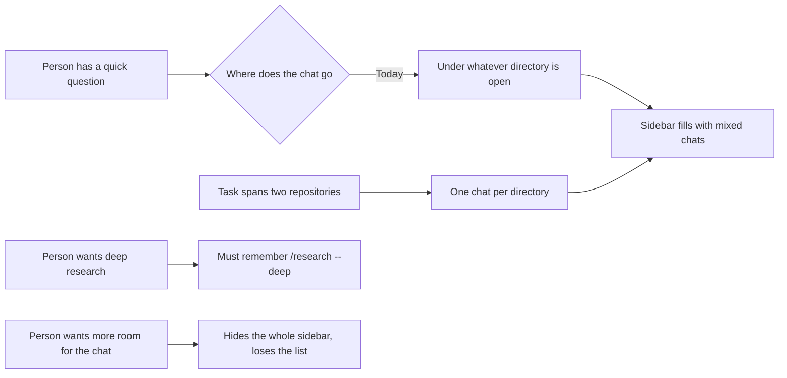

# R02 - Chats, projects, and chat modes: how a person organizes work and starts it from the prompt

| | |
|---|---|
| **Status** | Proposed. Nothing in it is implemented in crest; the technical plan is [0002-chats-projects-and-modes.md](../specs/0002-chats-projects-and-modes.md). |
| **Author** | AI (Cursor), from a Specky3 discovery |
| **Approver** | The crest maintainers |
| **Date** | 2026-11-01 |
| **Source** | Discovery `CREST-SIDEBAR`, "Organization of chats, projects and chat modes in the crest sidebar" |

crest keeps every chat under the one directory that was open when it started, lists those directories in a sidebar that is either full width or gone, and starts research and every other command only through typed `/` names in one flat list. A person cannot keep a quick question apart from any project, cannot group the several repositories one task touches, and has to remember command names to reach most of them. This document is the use cases and the requirements for fixing that, in terms a reader does not need crest's source to follow. The technical plan, with file names and line numbers, is [0002-chats-projects-and-modes.md](../specs/0002-chats-projects-and-modes.md).

## Terms

- **Chat**: one saved conversation with the agent.
- **Standalone chat**: a chat that belongs to no project and has no directory.
- **Project**: a named group of chats tied to one or more directories, in any location on disk.
- **Promote**: move a standalone chat into a new or an existing project.
- **Chat mode**: the kind of conversation the prompt starts: chat, research, or deep research.
- **Strip**: the narrow state of the sidebar, a column of icons.
- **Command group**: a named set of `/` commands (for example Flows, or Model & permissions) shown together in the palette.
- **Archive**: take a chat or a project out of the sidebar without deleting it; it can be restored.
- **Branch**: a new chat that starts with a copy of another chat's history and then goes its own way, leaving the original unchanged.
- **Shell line**: a prompt line that starts with `!`, such as `! cat ~/file`, which runs a command on the computer instead of asking the agent.

## Context: who runs into this

A developer uses crest every day across several repositories, and also asks it one-off questions that belong to no repository.



## Use cases

```mermaid
usecase-beta
  direction LR
  actor Person("Developer")
  systemBoundary crest["crest window"]
    UC01("UC-01 Start a standalone chat")
    UC02("UC-02 Promote a chat into a project")
    UC03("UC-03 Create a project with a directory")
    UC04("UC-04 Add or remove a project directory")
    UC05("UC-05 Find a chat or project")
    UC06("UC-06 Fold the sidebar to a strip or hide it")
    UC07("UC-07 Choose the chat mode from the prompt")
    UC08("UC-08 Browse commands by group")
    UC09("UC-09 Type a full command")
    UC10("UC-10 Reopen a chat saved before the change")
    UC11("UC-11 Archive or restore a chat or project")
    UC12("UC-12 Branch a chat")
    UC13("UC-13 Run a shell line")
  end
  Person --> UC01
  Person --> UC02
  Person --> UC04
  Person --> UC05
  Person --> UC06
  Person --> UC07
  Person --> UC08
  Person --> UC09
  Person --> UC10
  Person --> UC11
  Person --> UC12
  Person --> UC13
  UC02 ..> : extend UC03
  UC08 ..> : extend UC09
```

| ID | Use case | Today |
|---|---|---|
| UC-01 | Start a standalone chat | Not possible; a new chat always goes under the open directory. |
| UC-02 | Promote a chat into a project | Not possible; a chat cannot change directory. |
| UC-03 | Create a project with a directory | Partly; opening a directory makes it a heading, but it has no name of its own and cannot hold a second directory. |
| UC-04 | Add or remove a project directory | Not possible; a heading is exactly one directory. |
| UC-05 | Find a chat or project | Partly; the list is ordered by recency only, with no search or pin. |
| UC-06 | Fold the sidebar to a strip or hide it | Partly; the sidebar can be hidden, but there is no narrow state. |
| UC-07 | Choose the chat mode from the prompt | Not possible; research starts only from a typed command and a flag. |
| UC-08 | Browse commands by group | Not possible; `/` opens one flat list of eight visible rows. |
| UC-09 | Type a full command | Already works and must not break. |
| UC-10 | Reopen a chat saved before the change | Already works and must not break. |
| UC-11 | Archive or restore a chat or project | Not possible; deleting is the only way to clear the list, and it removes the history. |
| UC-12 | Branch a chat | Not possible; `/aside` opens a side chat that lives only in memory while a pipeline waits, and nothing copies a chat. |
| UC-13 | Run a shell line | Partly; the shell runs only as `/!cmd`, and a line typed as `! cmd` goes to the agent as a prompt. |

## Functional requirements

- **FR-1** (UC-01): A new chat can start with no project and no directory, and the sidebar lists it under a "Wild Chats" section, apart from the projects.
- **FR-2** (UC-01): A standalone chat reports that it has no directory, so a tool that needs files asks the person for a directory instead of failing or guessing.
- **FR-3** (UC-02): A standalone chat's menu offers "Add to project", and a chat in a project offers "Move to project" and "Remove from project". Moving keeps the chat's id and its whole history.
- **FR-4** (UC-02, UC-03): The project list in that menu ends with "New project", which asks for a name and a first directory and then moves the chat into the new project.
- **FR-5** (UC-03): A project cannot be created without a name and at least one directory.
- **FR-6** (UC-04): A project's menu lists its directories, adds a directory from any location, and removes one. Adding a directory the project already has changes nothing, and removing the last directory is refused with a message.
- **FR-7** (UC-04): Every chat in a project can read and write in every directory of the project, and the existing permission rules and the "outside the workspace" check apply to each of those directories.
- **FR-8** (UC-05): The sidebar shows projects, pinned ones first and then by most recent chat, each with its chats newest first and a count of its directories, then the standalone chats. A search field filters chats by title.
- **FR-9** (UC-05): A project can be renamed and pinned, and a new chat can start inside a given project from that project's row.
- **FR-10** (UC-06): The sidebar has three states and opens hidden. Full is the list. The strip is a fixed column with the Crest mark, a new chat, search, the projects, and one initial per project; hovering an initial shows that project's name. One keyboard shortcut cycles full, strip, hidden, and full again.
- **FR-23** (UC-06): Hidden holds only the Crest mark, in the top left, and stops where the prompt starts. While it is closed the conversation uses the full width and starts below the mark, so the mark covers no block and leaves no empty column. Hovering the mark, or moving the keyboard focus onto it, shows the strip's rows as a bar that floats over the conversation, which does not move; the rows end at the prompt. Leaving hides the rows and the state stays hidden. Clicking the mark opens the full sidebar, and the mark in the full sidebar returns to hidden.
- **FR-11** (UC-07): One button at the start of the prompt opens a menu with the chat modes (Chat, Research, Deep research) and insertions for a workspace file and a command.
- **FR-12** (UC-07): The chosen mode shows as a chip in the prompt that reads its name. Sending in research mode runs the same research as `/research <text>`, and deep research the same as `/research --deep <text>`. The chip's ×, Backspace on an empty prompt, or choosing Chat returns to normal chat.
- **FR-13** (UC-08): Typing `/` alone lists command groups with their command names and counts. Choosing a group shows only its commands, and going back returns to the groups.
- **FR-14** (UC-08): Every built-in command belongs to exactly one named group, and a plugin's commands go in a group named after that plugin.
- **FR-15** (UC-09): Typing any part of a command after `/` filters across all groups, as today, and labels each row with its group. Every command name and alias that works today still runs when typed in full.
- **FR-16** (UC-10): After the change, every chat saved today is listed under a project of one directory, named after that directory, and opens with its history.
- **FR-17** (UC-01): A chat's menu starts with "New chat", which opens a new chat in the same project, or a standalone one when the chat has no project. A project's menu also offers "New chat" in that project.
- **FR-18** (UC-11): A chat's menu and a project's menu offer "Archive". An archived chat leaves its section, and an archived project leaves the list together with its chats. Archiving deletes nothing.
- **FR-19** (UC-11): A folded "Archived" section at the end of the sidebar shows how many items are archived and lists them. Each row has a restore button that puts the chat or the project, with its chats, back where it was.
- **FR-20** (UC-12): A chat's menu offers "Branch chat". It creates a new chat titled after the original with "(branch)", in the same project, holding a copy of the history up to that moment, and opens it. The original chat and its history do not change.
- **FR-21** (UC-12): A branch shows where it came from: a branch icon on its row and, at the top of its conversation, the title of the original and how many blocks were copied.
- **FR-22** (UC-13): A prompt line that starts with `!` runs the rest of the line as a shell command, in every chat mode; the mode is never applied to it. The palette lists the command as `!` under Chat, and `/!cmd` still works.

## Non-functional requirements

- **NFR-1 (room for the conversation):** At 1280 pixels wide with the full sidebar, the conversation keeps at least 75 percent of the window. With the strip at 1024 pixels, it keeps at least 90 percent. While hidden is closed the conversation keeps the full width. While its rows are showing they float over the conversation, which does not move or reflow.
- **NFR-2 (fixed cost in the prompt):** The mode button and the mode chip together take at most 160 pixels at 1280 pixels wide, whatever mode is chosen.
- **NFR-3 (keyboard complete):** Every action in this document can be done from the keyboard. The sidebar toggle shortcut, the chat shortcuts, focus movement, and typed commands keep working; every new button or menu is an extra path, not the only one.
- **NFR-4 (no data loss):** Moving to the new grouping loses no saved chat, title, or history, and it can run on a store that already holds chats. Archiving, restoring, and branching never remove a block from any chat.
- **NFR-5 (plugins unchanged):** Existing plugins and their aliases need no change to appear in the grouped palette.
- **NFR-6 (one level):** Projects hold chats directly. There are no folders inside projects, so finding a chat never takes more than one fold.
- **NFR-7 (evidence):** Every claim about current behavior traces to a file in crest's source or to a public page of another product, recorded in the discovery this document comes from.

## What this does not cover

- The timeline blocks, the activity line, the status bar, and the questions rail, which [R01](R01-visibility-and-reach.md) covers.
- The file tree panel on the right side.
- The stages and gates inside the research, implement, and simulate pipelines; only how research is started changes.
- The Lua plugin API. Plugins gain a group without any change to how they register commands.
- Renaming commands. If a name is ever changed, the old one stays as an alias.
- Drag and drop between projects, and folders inside a project.
- Branching from an earlier block than the last one, and merging two branches back together.
- crest's source is not touched by this document. A working prototype of UC-01 through UC-09 and UC-11 through UC-13 exists in the browser mock; [0002-chats-projects-and-modes.md](../specs/0002-chats-projects-and-modes.md) plans its port.

## Sources

| What | Where |
|---|---|
| The discovery that found these gaps | `.aos/journal/CREST-SIDEBAR/person/01-discovery.md` (Findings, Desired state, Breakdown) |
| Why the easier fix for each was rejected | `.aos/journal/CREST-SIDEBAR/agent/analysis/risks.md` (Systemic Risks) |
| The approved plan, in crest's own terms | `.aos/journal/CREST-SIDEBAR/person/01-discovery.md` (Solution proposal) |
| The spikes that tested each part | `.aos/journal/CREST-SIDEBAR/agent/spikes/S01.md` to `S06.md` (S04 not satisfactory, replaced by S06) |
| What ChatGPT, Claude, Gemini, and Cursor do | `.aos/journal/CREST-SIDEBAR/agent/sources/industry.md` and `screenshots.md` |
| A working prototype | `mock/src/organization.js`, `mock/src/commands.js`, `mock/src/modes.js`, and the `chats-panel` and `prompt-input` components |
| Archive, branch, and shell line in the prototype | `mock/scripts/sidebar-extras-check.mjs` (9 checks); added after the discovery's review, so they rest on the prototype and on crest's `crates/ui/src/input.rs` (`classify_line`) and `crates/app-core/src/usecases/catalog.rs` (`/!` entry) |
| The technical plan for the crates | [0002-chats-projects-and-modes.md](../specs/0002-chats-projects-and-modes.md) |
