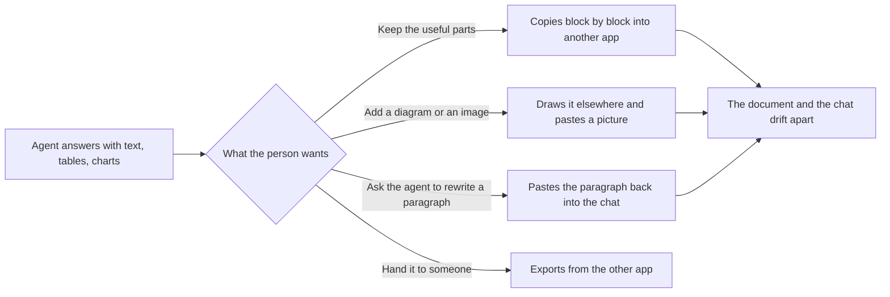

# R03 - Chat documents: write, edit, and export markdown documents that live beside a chat

| | |
|---|---|
| **Status** | Proposed. The decisions below are confirmed (2026-11-11). Nothing in it is implemented in crest's source; a working prototype is in the browser mock. The technical plan is [0003-chat-documents.md](../specs/0003-chat-documents.md). |
| **Author** | AI (Cursor), from the browser mock |
| **Approver** | The crest maintainers |
| **Date** | 2026-11-11 |
| **Source** | The prototype in `mock/` (`docs.js`, `doc-actions.js`, `doc-panel`, `lib/markdown.js`, `lib/mermaid-view.js`) and the sessions in which it was built. No Specky3 discovery. |

A developer or an engineer reads a long answer in the chat, wants to keep the useful parts, and has to copy them by hand into a file somewhere else, then format, illustrate, and export that file with other tools. The people this is for are not markdown writers: they know what a heading and a list are, and they should never have to type `##` or a fence. This document is the use cases and the requirements for a document that belongs to a chat, built from the chat's blocks, edited as a rendered page, and exported. The technical plan, with file names and line numbers, is [0003-chat-documents.md](../specs/0003-chat-documents.md).

## Terms

- **Doc**: one markdown document that belongs to one chat. A chat can have several.
- **Doc panel**: the area that shows the doc beside the chat or in its place.
- **View**: how much of the window the doc panel takes. Hidden, split (chat and doc side by side), or doc alone.
- **Page**: the doc drawn as a document (headings, lists, tables, images, diagrams) that the person edits directly.
- **Source**: the same doc as plain markdown text.
- **Diagram**: a Mermaid diagram written in a doc as a fenced block that starts with `mermaid`.
- **Diagram editor**: a screen that replaces the page while a diagram is edited, with the drawing on the left and its code on the right.
- **Reference**: a chip on the prompt that points at a doc, so the next message is about that doc.
- **Block**: one item of the chat's timeline (a text reply, a table, a chart).

## Context

A person has a conversation with the agent and wants a written result out of it.



## Use cases

```mermaid
usecase-beta
  direction LR
  actor Person("Developer or engineer")
  systemBoundary crest["crest window"]
    UC01("UC-01 Add a chat block to a doc")
    UC02("UC-02 Add selected chat text to a doc")
    UC03("UC-03 Show the doc beside the chat, alone, or hide it")
    UC04("UC-04 Edit the doc as a rendered page")
    UC05("UC-05 Edit the markdown source")
    UC06("UC-06 Insert an image")
    UC07("UC-07 Add or edit a diagram")
    UC08("UC-08 Ask the agent to change the doc")
    UC09("UC-09 Export a doc")
    UC10("UC-10 Create, rename, switch, and delete a chat's docs")
    UC11("UC-11 Find and open any doc")
    UC12("UC-12 Reference a doc in the next message")
    UC13("UC-13 Come back to a doc later")
  end
  Person --> UC01
  Person --> UC02
  Person --> UC03
  Person --> UC04
  Person --> UC05
  Person --> UC08
  Person --> UC09
  Person --> UC10
  Person --> UC11
  Person --> UC12
  Person --> UC13
  UC06 ..> : extend UC04
  UC07 ..> : extend UC04
  UC12 ..> : extend UC11
```

| ID | Use case | Today |
|---|---|---|
| UC-01 | Add a chat block to a doc | Not possible. A block can be copied and pasted into another app. |
| UC-02 | Add selected chat text to a doc | Not possible; the selection can be copied. |
| UC-03 | Show the doc beside the chat, alone, or hide it | Not possible; there is no doc. |
| UC-04 | Edit the doc as a rendered page | Not possible. |
| UC-05 | Edit the markdown source | Not possible. A markdown block in the chat can be toggled to its source but not changed. |
| UC-06 | Insert an image | Not possible. |
| UC-07 | Add or edit a diagram | Partly; a diagram block in the chat can be drawn, zoomed, and copied, but not written or changed by the person. |
| UC-08 | Ask the agent to change the doc | Not possible; the person pastes text into the prompt. |
| UC-09 | Export a doc | Not possible. |
| UC-10 | Create, rename, switch, and delete a chat's docs | Not possible. |
| UC-11 | Find and open any doc | Not possible. |
| UC-12 | Reference a doc in the next message | Not possible; a file can be mentioned with `@`, and it is read as any other file. |
| UC-13 | Come back to a doc later | Not possible. |

## Functional requirements

- **FR-1** (UC-01): A block that belongs in a document (a text reply, a table, a chart, a computed result, a diff, or the person's own message) has "Add to doc" and "Add to a new doc" in the menu next to its copy button. Blocks of other kinds (tool calls, thinking, errors, stage markers) do not offer them.
- **FR-2** (UC-01): "Add to doc" puts the block at the end of the chat's current doc as its own section, and creates the doc when the chat has none. "Add to a new doc" always creates one. After adding, the doc panel shows the doc (split, when it was hidden), and the new section is highlighted for a moment.
- **FR-3** (UC-01): A chart is added as a picture of the chart. When the picture cannot be made, the chart is added as its table.
- **FR-4** (UC-02): Selecting text in the chat shows a small bar with Copy and "Add to doc". Choosing it adds the selected text at the end of the current doc.
- **FR-5** (UC-03): The doc panel has three views: hidden, split, and doc alone. In split the divider can be dragged, and each side keeps at least a quarter of the window. In doc alone the prompt stays at the bottom, and a strip shows the agent's latest message with a "show chat" control. One keyboard shortcut cycles hidden, split, and doc alone; `/doc split`, `/doc only`, and `/doc close` choose a view.
- **FR-6** (UC-04): The doc shows as a page: headings, lists, quotes, code, tables, images, and diagrams drawn as they will read. The person types, selects, and deletes on the page itself. A toolbar above it offers Bold, Italic, Heading, List, Quote, Code, Link, Insert image, and New diagram, each with its name as a tooltip.
- **FR-7** (UC-04): A toolbar format toggles. Applying Bold to bold text removes it; Heading, List, and Quote turn their mark on or off for every selected line. A Link asks for an address first and does nothing when none is given.
- **FR-8** (UC-05): "source" switches the same doc to its markdown text, and "preview" switches back. The toolbar works on the selection in the source as it does on the page, and Esc returns to the page.
- **FR-9** (UC-06): Insert image opens a file picker. The chosen image is stored with the doc, appears in place on the page, and takes its description from the file name.
- **FR-10** (UC-07): Each diagram on the page shows an "edit" button while the pointer is over it, and a double-click opens it too. The diagram editor replaces the page: the drawing on the left, its code on the right, redrawn shortly after the person stops typing.
- **FR-11** (UC-07): Save writes the diagram back in the same place and returns to the page. Cancel and Esc return without changing the doc. Saving empty code on an existing diagram removes it, and on a new one adds nothing.
- **FR-12** (UC-07): New diagram, on the toolbar, opens the same editor on a new diagram that will go after the block where the cursor is: at the end when the page has no cursor, and at the start of an empty doc. The editor offers starting points (Flowchart, Sequence, Pie, Timeline, and Use case, each offered only when crest can draw it), and its button reads "Add to doc".
- **FR-13** (UC-07): The divider between the drawing and the code can be dragged between 15 and 85 percent, moved with the arrow keys when it has focus, and reset to the middle by a double-click. The position is kept the next time the editor opens. A narrow doc panel stacks the drawing above the code, and the divider works the same way.
- **FR-14** (UC-07): The drawing has zoom controls: zoom out, zoom in, the current percentage (a click shows the actual size), and "fit", which is the default and follows the pane's size. Ctrl or Cmd with the mouse wheel zooms smoothly, and a drawing larger than the pane is dragged to move around it. Steps run from 25 to 400 percent, and the wheel reaches 800.
- **FR-15** (UC-07): Code that cannot be drawn shows the reason and the code in place of the drawing. The text is never lost, and Save still keeps it.
- **FR-16** (UC-08): Selecting a passage on the page shows a bar with Copy and "Ask agent". "Ask agent" puts the passage on the prompt as a chip, and the next message tells the agent what to do with it. The agent's change replaces that passage in the doc.
- **FR-17** (UC-08): The agent can write a new doc or rewrite an existing one. The doc panel updates as the agent writes and names who made the last change.
- **FR-18** (UC-09): Export offers Markdown (one `.md` file with its images inside), Web page (`.html`), PDF (opens the print dialog so the person saves a PDF), and Copy as markdown. The file name is the doc's title in lower case with hyphens.
- **FR-19** (UC-10): "New doc" creates an empty doc titled after the chat. Clicking the title renames it. A chat with several docs lets the person switch between them from the title. Delete removes the doc after it is chosen on purpose.
- **FR-20** (UC-11): The sidebar has a Docs section that lists every doc, newest first, each with the chat it belongs to, and the sidebar's search filters it by title. Clicking a doc opens it alone, over its own chat, whose prompt stays at the bottom. A chat that has docs shows a small document mark on its row.
- **FR-21** (UC-11, UC-12): The palette has a Docs group of `/doc` commands: `/doc` (open this chat's doc, or create it), `/doc new [title]`, `/doc find <text>`, `/doc open <title>`, `/doc use [title]`, `/doc add`, `/doc split`, `/doc only`, `/doc close`, `/doc source`, and `/doc export [md|html|pdf|copy]`. `/doc <title>` opens the doc with that title. Typing after `find`, `open`, or `use` lists the matching docs as rows. When several docs match one query the window says how many and asks the person to pick, and when none match it says so.
- **FR-22** (UC-12): `/doc use`, and the prompt's "+" menu entry "Document", put a chip with the doc's title on the prompt. The next message goes to the agent with that doc as the one to change, and the sent message shows `↳ <title>`.
- **FR-23** (UC-13): Every doc is a plain `.md` file. For a chat in a project the file is `<first directory of the project>/.crest/docs/<chat id>/<title>.md`, and for a chat with no project it is `<crest data directory>/docs/<chat id>/<title>.md`. Images sit in an `assets/` folder beside it. The doc panel shows the file's path.
- **FR-24** (UC-13): Edits are saved a moment after the last keystroke, and the panel says "saved" once they are on disk. A save that fails says so and keeps the text on screen.
- **FR-25** (UC-13): Reopening a chat shows the doc that was open, or its latest one. When a chat moves to another project, or out of one, its docs move to the new place. When the first directory of a project is removed, the docs of its chats move to the new first directory.

## Non-functional requirements

- **NFR-1 (no markdown knowledge):** Every action of UC-04, UC-06, and UC-07 can be done without typing any markdown or Mermaid mark, except the diagram's own code, which the editor starts from a template.
- **NFR-2 (no loss):** Moving to the doc feature changes no chat, title, or block. Switching views, opening the diagram editor, and cancelling it leave the doc's text as it was. Deleting a chat removes the doc from the list and leaves its files on disk.
- **NFR-3 (keyboard complete):** Every action in this document can be done from the keyboard. In the diagram editor, Ctrl or Cmd with Enter or S saves, Esc cancels, and Ctrl or Cmd with + , - , and 0 zoom in, zoom out, and fit. The new buttons and menus are extra paths, not the only ones.
- **NFR-4 (plain files):** A doc's file opens in any markdown editor and reads correctly there: images are relative links and a diagram is a fenced block that starts with `mermaid`.
- **NFR-5 (room):** In split, the chat and the doc each keep at least 25 percent of the space the sidebar leaves them, whatever width the window has.
- **NFR-6 (diagram limits):** A diagram's code is cut at 8,000 characters when drawn, the limit the chat's diagram block already has, and the editor says so.
- **NFR-7 (agent edits follow permissions):** The agent's changes to a doc follow the same permission mode as its changes to a file: the default mode asks, accept-edits applies them.
- **NFR-8 (themes):** The page, the editor, and the diagrams follow the dark and the light theme.
- **NFR-9 (evidence):** Every claim about current behavior traces to a file in crest's source, and every behavior asked for traces to the prototype or to a public page of Mermaid.

## Decisions

Confirmed by the maintainer on 2026-11-11. These were open while the prototype was built; the requirements above already state the confirmed choice.

| Question | Decision | Why |
|---|---|---|
| Does the sidebar hide when a doc is shown alone? | No. The sidebar keeps the state the person gave it (FR-5, FR-20). | R02 already gives the person three sidebar states. |
| Is the strip with the agent's latest message enough in doc alone? | Yes (FR-5). | The prompt stays at the bottom, so the person can answer, and "show chat" is one click. |
| Export with images inside one file, or a folder with `assets/`? | One file, images inside (FR-18). | One file travels by mail or chat. A folder export is listed below as not covered. |
| What happens to a doc when its chat is deleted? | The doc leaves the list and its files stay on disk (NFR-2). | A file the person wrote is never deleted behind their back. |
| Who judges the agent's edits to a doc? | The permission mode, as for a file (NFR-7). | The default mode asks and accept-edits applies them. The prototype applies agent edits at once; the crates follow the permission mode. |

## What this does not cover

- Several people editing one doc, comments, sharing, and version history. The editor's own undo is all the history there is.
- Exports to Word, to a folder with `assets/`, or a PDF written without the print dialog.
- A table editor on the toolbar. A table arrives from the chat or from the source, and the page edits its cells as text.
- Diagram types the renderer cannot draw. The editor shows the reason (FR-15).
- Docs that belong to no chat, and moving a doc from one chat to another.
- Copying a chat's docs when the chat is branched ([R02](R02-chats-projects-and-modes.md), FR-20). A branch starts without docs.
- Linking from one doc to another, and a table of contents.
- The Lua plugin API. A plugin's blocks can be added to a doc only when they are one of the kinds in FR-1.

## Sources

| What | Where |
|---|---|
| The prototype: model, actions, panel, diagram editor | `mock/src/docs.js`, `mock/src/doc-actions.js`, `mock/src/components/doc-panel/`, `mock/src/lib/markdown.js`, `mock/src/lib/mermaid-view.js` |
| The prototype's sidebar section, palette group, and prompt chip | `mock/src/components/chats-panel/chats-panel.js`, `mock/src/commands.js`, `mock/src/components/prompt-input/prompt-input.js` |
| The prototype's server routes | `mock/server/api.js` (`/api/docs`) and `mock/server/data.js` |
| Screenshots of the states in this document | `mock/spikes/evidence/docs-split.png`, `docs-toolbar.png`, `docs-selchat.png`, `docs-seldoc.png`, `docs-commands.png`, `docs-diagram-hover.png`, `docs-diagram-resize.png`, `docs-diagram-narrow.png`, `docs-diagram-new.png`, `docs-diagram-usecase.png` |
| What the chat already draws and copies | `crates/ui/src/blocks/mermaid.rs`, `crates/ui/src/blocks/markdown.rs`, `crates/ui/src/blocks/copy.rs` |
| The chat, project, archive, and branch rules this builds on | [R02-chats-projects-and-modes.md](R02-chats-projects-and-modes.md) |
| Mermaid use case syntax | https://mermaid.ai/open-source/syntax/usecase.html |
| The technical plan for the crates | [0003-chat-documents.md](../specs/0003-chat-documents.md) |
