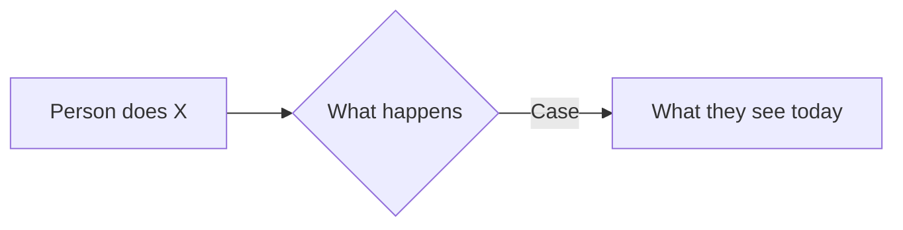

# Requirement template

Copy this file to `docs/requirements/Rnn-short-name.md`. `Rnn` is the next free number (`R01`, `R02`, …). Fill every placeholder. Delete nothing that is a heading. The worked example is [R01-visibility-and-reach.md](R01-visibility-and-reach.md).

This document is for a person. It says what someone can do, and what must stay true, without file names or line numbers. A technical plan, if one is needed, goes in `docs/specs/` and is linked from the status table and from Sources.

Rules:

- One use case is one thing a person does. Name it `UCnn` in the diagram, the table, and the requirements that satisfy it.
- A functional requirement cites the use cases it satisfies: `**FR-n** (UC-01): …`.
- A non-functional requirement says a limit that is not a new action: timing that must not change, no regression, scope, evidence.
- Keep the context flowchart. It shows the situation the requirements answer, not the design.
- The use-case diagram is `usecase-beta`. The Mermaid plugin draws it. Do not add an SVG next to it.
- `..> : include` means the first use case always does the second. `..> : extend` means the first is optional on top of the second.
- One statement per line inside the diagram.

# Rnn — Title

| | |
|---|---|
| **Status** | Proposed. Nothing in it is implemented. |
| **Author** | |
| **Approver** | The crest maintainers |
| **Date** | YYYY-MM-DD |
| **Source** | |

One short paragraph: who this is for, and what they cannot do today. Link the technical plan in `docs/specs/` here when it exists.

## Terms

- **Term**: one sentence a reader needs before the rest.

## Context

One sentence on when this happens.



## Use cases

```mermaid
usecase-beta
  direction LR
  actor Person("Who")
  systemBoundary crest["crest window"]
    UC01("UC-01 What the person does")
  end
  Person --> UC01
```

| ID | Use case | Today |
|---|---|---|
| UC-01 | What the person does | Not possible, or already works and must not break. |

## Functional requirements

- **FR-1** (UC-01): What the window does after this change.

## Non-functional requirements

- **NFR-1:** A limit that is not a new action (timing, no regression, scope, evidence).

## What this does not cover

- One thing a reader might expect that this document leaves out.

## Sources

| What | Where |
|---|---|
| Where this came from | |
