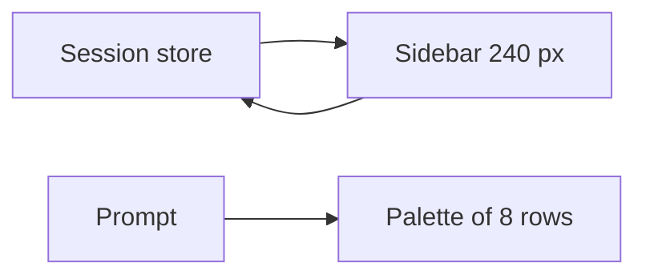
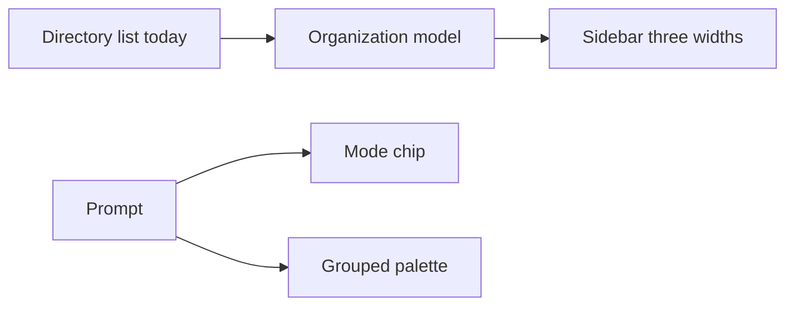

# CREST-SIDEBAR - Organization of chats, projects and chat modes in the crest sidebar

## Goal

Enable the people who use crest to organize work as standalone chats and as projects that span one or more directories. The same outcome is a collapsible sidebar and a grouped command set, so most of the window stays with the conversation.

## Background

crest is a desktop coding agent. The person opens a directory, types a prompt, and reads the answer in a timeline of blocks. Every saved chat belongs to the directory where it started.

Beside the timeline, a sidebar offers a new chat and then each directory already opened, with its chats newest first. The list holds at most 20 directories. The sidebar is a fixed 240 pixels wide, and one action shows or hides it whole.

The prompt starts every other action through typed commands. Typing a slash opens a palette of eight rows over one flat list of about 30 built-in names. That list mixes settings, accounts, pipelines, and stage controls.

Research runs as a typed command with five stages, or as a deep variant with fourteen, and no control in the prompt shows the kind of chat. The maintainer wants the patterns of ChatGPT, Gemini, Claude, and Cursor. In those products a chat can live alone or inside a project, the sidebar folds to a strip, and a button chooses research or deep research.

A chat is one saved conversation with the agent. A standalone chat belongs to no project. A project is a named group of chats tied to one or more directories, in any location. Promoting a chat means moving a standalone chat into a project. A chat mode is normal chat, research, or deep research.

## Constraints

* The deliverable is a solution, its requirements, and its specs, and the investigation does not change the product.
* Everything built during this work lives in a browser mock of the window, and the product source is only read.
* Chats already saved, each tied to one directory, stay readable and listed after the new grouping.
* Keyboard use stays complete, so existing shortcuts and a fully typed command keep working, and every new button is an extra path.
* The mock uses no layout the native window cannot draw later.
* Plugin commands and their aliases fit the new grouping with no change to existing plugins.
* Other products are studied through their public pages and the screenshots provided, nothing is copied, and the license stays GPL.
* The window keeps most of its width for the conversation, so the sidebar and the prompt controls take little space.

## Scope

### In

* The left sidebar: standalone chats, projects with several directories, promoting a chat, ordering, and search.
* How the sidebar collapses: hidden, a narrow strip of icons, or full width.
* A control at the start of the prompt that chooses normal chat, research, or deep research.
* How built-in and plugin commands are grouped and found in the palette.
* What the saved chats and the project model must record, stated as requirements.
* The browser mock, the requirements, and the spec.

### Out

* Any change to the product source or the native window.
* The timeline, the activity line, the status bar, and the questions rail, which a separate ticket covers.
* The file tree on the right side.
* The stages and gates inside the research, implement, and simulate pipelines.
* The plugin API and the behavior of existing plugin commands.

## Problem Space

### Findings

#### Chats and projects

* Every saved chat stores a single directory, and a project is only that directory, with no name of its own.
* A new chat is always created inside the directory that is open, so no chat exists without a directory.
* The sidebar lists at most 20 recent directories, each with its chats ordered only by recency.
* The roadmap calls this list every project's chats, while the project command only closes one directory and opens another.

#### Sidebar width

* The sidebar is a fixed 240 pixel panel, and the conversation loses that width while the panel shows.
* One action shows or hides the whole panel, with no narrow state between the two.

#### Modes and commands

* Research and deep research start only from typed commands, one of them a deep flag.
* The palette shows eight rows over one flat list, and a command has no group.
* Plugin commands join the same list after the built-in ones.

#### Industry patterns

* Cursor lets one chat work across several folders, so a cross-repository task needs one chat instead of one per folder.
* ChatGPT recommends a chat without a project when the work is self-contained.

### Current System

Saved chats are grouped by their one directory, each directory becomes a sidebar heading, and the prompt reaches every mode through typed text in one palette of eight rows. Chats that require an open directory, and commands in that flat list, both raise the effort to reach a chat, a mode, or a command. That effort lowers use of the research modes and keeps the full sidebar taking width from the timeline.

## Desired state

When this work is done, the mock, the requirements, and the spec describe a crest where:

1. **Standalone chats**: A person can start a chat with no directory, and later move it into a new or existing project without losing its history.
2. **Projects of several directories**: A project has its own name and one or more directories in any location, and every chat in it reaches all of them. Each directory that already holds chats becomes a project of one directory.
3. **A sidebar in three widths**: The sidebar is full, a narrow strip of icons, or hidden. The strip still offers a new chat, search, and the projects.
4. **Chat mode from the prompt**: A control at the start of the prompt shows the current mode. It switches among normal chat, research, and deep research without typing a command.
5. **Grouped commands**: Typing a slash shows built-in and plugin commands under named groups, and the list filters as the person types. A full typed command still runs.
6. **Room for the conversation**: At the default window size the timeline keeps most of the width in every sidebar state.

## Gap

crest lacks a project that exists apart from one directory, a chat that exists apart from any directory, a narrow sidebar, a prompt control for the chat mode, and a group on each command. The pathways that raise the effort to reach a chat, a mode, or a command therefore stay unchecked.

## Breakdown

1. Every chat is bound to the one directory that was open when it started. No chat can exist alone, and a task across several directories needs one chat per directory.
2. A project has no identity apart from a directory. The store and the sidebar know only that directory, so a project cannot carry its own name, gather several directories, or receive a promoted chat.
3. The slash commands share one flat list with no groups. Built-in and plugin commands mix settings, accounts, pipelines, and stage controls in eight visible rows, so a person must recall a name to reach most of them.
4. The chat modes have no control in the prompt. Research and deep research start only from typed commands and a flag, so the prompt never shows which mode a chat is in.
5. The sidebar has only two widths, full or hidden. A person who needs the list gives the panel its full width, and the timeline loses that width for the whole session.

## Solution proposal

### Proposed approach

A project record gets its own id, name, pin, and list of directories, and a chat's project becomes optional. A chat then lives alone or inside one project and reaches every directory of that project. Today's directory list migrates to one project per directory. The sidebar shows pinned and recent projects above standalone chats, and it switches among a full panel, a strip of icons, and nothing. One button at the start of the prompt opens the chat modes, the chosen mode shows as a chip, and a slash shows commands under named groups first. A browser mock implements all of it, and each step avoids a simpler fix that would lose data, hide commands, or crowd the prompt.

### 1. Standalone chats that can be promoted

A chat stores an optional project instead of a required directory, so a new chat can start with no directory and sit under the standalone section. Its menu offers add to project, which moves it into an existing project or into a new one made from a name and a directory, and the chat keeps its id and its history. Search filters that list, and a chat with no files reports zero directories so a tool that needs files asks for one instead of failing.

### 2. Projects with their own identity and several directories

A project is a record with an id, a name, a pin, and one or more directories in any location, and every chat in it reaches all of them. The migration turns each directory that already holds chats into a project of one directory and keeps every chat id. Adding a directory ignores a duplicate, and removing the last directory is refused. Existing chats stay listed, permission rules apply to every directory of the project, and the sidebar stays one level deep, with pin and search instead of folders.

### 3. Commands under named groups

Every command row carries a group, from a fixed table for the 27 built-in names and from the registering plugin for the rest. Typing a slash alone shows the groups first: Chat, Flows, Stages, Model and permissions, Workspace, App, and one row per plugin. Typing a prefix still filters across all commands and tags each row with its group. No command is renamed or removed, and plugins need no change.

### 4. A chat mode control at the start of the prompt

One round button at the start of the prompt opens a menu of Chat, Research, and Deep research, plus insertions for a file and a command. The chosen mode shows as a compact chip that reads its name, and sending then becomes the research command or the deep research command. A first chip that included an icon measured 180 pixels and missed a 160 pixel limit. The compact chip measures 137 pixels. A shortcut cycles the modes, and Backspace on an empty prompt returns to normal chat.

### 5. A sidebar in three widths

The sidebar keeps its 240 pixel full state and gains a 48 pixel strip with new chat, search, projects, and one initial per project, while hidden takes no width. One shortcut cycles full, strip, and hidden. At 1280 pixels the conversation keeps 81 percent of the window with the full sidebar. At 1024 pixels it keeps 95 percent with the strip. Hiding the list by default, or shrinking the full panel, is the fix this avoids.

### Future work

A later ticket ports this model into the product: a projects table, a migration of today's directory field, and tools that resolve every directory of a project. That ticket also ports the sidebar states and the prompt control into the native window. It covers command aliases, drag and drop between projects, and folders inside a project, none of which this discovery tested.
