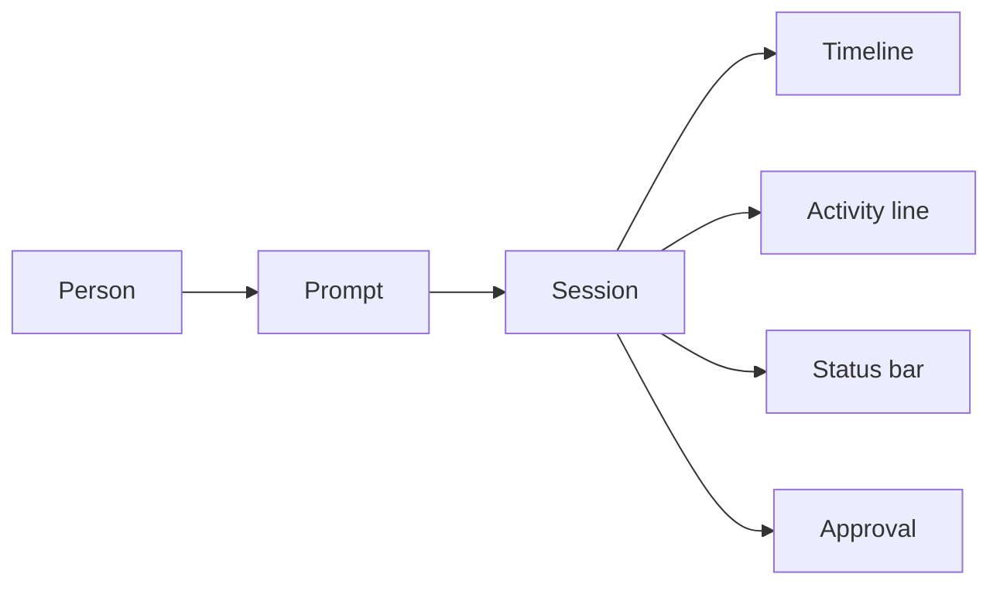
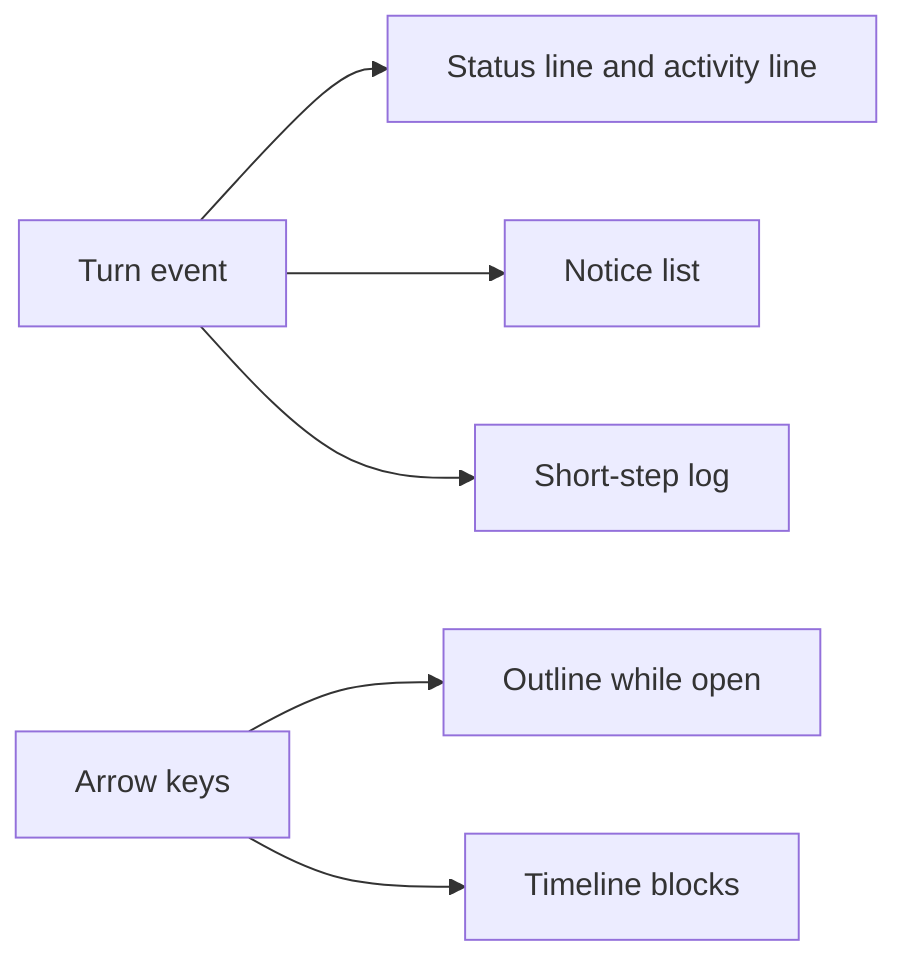

# CREST-UX - Visibility and reach in the crest window

## Goal

Enable the maintainer of crest to identify and rank graphical-interface weaknesses against patterns for agentic applications. The outcome is a ranked list of problems, backed by the code and the literature, that can ground a redesign.

## Background

crest is a desktop coding agent. A person opens a repository, submits a prompt, and reads a timeline of blocks: narrative text, reasoning, tool calls, diffs, tables, charts, and cards. Around that timeline sit a chats sidebar, a file tree, an activity line, a prompt, and a status bar.

The agent works on the person's files. A write or a command normally waits for approval, unless the active permission mode already allows it. Multi-step flows such as research, implementation, and simulation pause at gates where the person chooses whether to continue.

An earlier review compared the window with design literature for agentic tools. That review named likely gaps, but it did not rank them, tie them to measurements in the product, or trace them to a concrete choice in the window.

The readers of this discovery are the maintainers of crest. The redesign it prepares is for scientists and engineers who use crest on their analyses and their code. How those people actually work with crest has not been measured.

An agentic application is software in which a model plans and runs several tool steps for a person. Shared control is the person's ability to see, interrupt, redirect, or undo those steps. A permission mode is the policy for which actions need approval: Ask, AutoEdit, or Plan.

## Constraints

* The investigation covers the graphical interface only. The command line and the headless mode are a separate ticket.
* Evidence about the code comes from the current tree. Evidence about users comes from studies or observation, never from assumption.
* Design literature is cited with the work and the passage. A pattern backed by a single work is marked as such.
* The crest source is not modified. Prototypes of interface changes live in a browser mock of the current window.
* The real window cannot be opened by the investigating agent, so visual checks use the mock or screenshots.
* crest has no telemetry of how scientists and engineers use it, so a statement about their behavior needs a source outside the repository.

## Scope

### In

* The graphical window: timeline, chats sidebar, file tree, activity line, prompt, status bar, approval dialog, and question outline.
* How those surfaces compare with recognized patterns for agentic interfaces, judged for scientists and engineers.
* A ranked list of weaknesses backed by the current code and by the design literature.
* Prototypes that check layout and interaction without changing crest.

### Out

* The command line and the headless mode.
* Any change to the crest source.
* New telemetry or a fresh study of how scientists and engineers use crest.
* Building the redesigned interface in the product. The ticket stops at the proposal.

## Problem Space

### Findings

#### Notices and activity

* A status-bar notice lasts 6 seconds.
* The activity line stays hidden for the first 150 ms. Work shorter than that never shows the line.
* A longer notice lifetime lowers the unseen-error count. A longer activity delay lowers shared control.

#### Panels

* The chats sidebar is 240 px wide and starts visible.
* The file tree is 280 px wide.
* Both widths are fixed. Neither panel is resized by dragging.

#### Questions and control

* The outline lists the person's questions. Up and Down still move timeline blocks while it is open, and Escape closes the outline.
* Greater question reach raises shared control. A higher unseen-error count lowers shared control.
* Permission mode is Ask, AutoEdit, or Plan, and Ask is the default.

#### Where the behavior lives

* The session is the hub. It drives the activity line, the approval dialog, the status bar, the timeline, the file tree, and the prompt.
* The readers of the investigation are the maintainers. The people the interface is for are scientists and engineers.

### Current System

The person types a prompt and the session runs the turn, painting the timeline, the activity line, the status bar, and an approval dialog when permission is required. Notices last 6 seconds, the activity line waits 150 ms, chats start at a fixed 240 px, and the file tree takes a fixed 280 px. A longer notice lowers unseen errors, while unseen errors and a longer activity delay lower shared control, and greater question reach raises it, with no path back.

## Desired state

Scientists and engineers can follow a crest run and take it back, because the interface keeps the agent's state visible and reachable:

1. **Durable notices**: An error, a retry, or a fallback stays listed until the person has seen it, instead of leaving the status bar after 6 seconds.
2. **Visible progress**: Steps shorter than 150 ms and long stages both show what the agent is doing, and whether it is working or waiting for the person.
3. **Reachable questions**: The person moves among their questions with the keyboard, including while the outline is open, and lands on the matching block.
4. **A readable timeline**: The chats sidebar and the file tree can leave enough width for the timeline on a narrow window, instead of holding a fixed 240 px and 280 px.
5. **Shared control**: The person can see, interrupt, redirect, or undo the agent's step from the same window, and a missed error does not lower that ability for the rest of the session.

## Gap

The window can run a turn, but it cannot keep a notice, a short step, or a question reachable for the whole session. Notice lifetime and activity delay are fixed, arrow keys never move the outline, and the side panels hold a fixed width, with no path that restores those timings.

## Breakdown

1. A status-bar notice disappears after 6 seconds, so an error can leave both the bar and the visible timeline. A longer notice lifetime lowers unseen errors, and fewer unseen errors raise shared control.
2. A step shorter than 150 ms never appears on the activity line, so the person cannot see or redirect it. A longer activity delay lowers shared control, because work shorter than the delay never appears.
3. Arrow keys move timeline blocks while the question outline is open, so an earlier question is not reachable from the keyboard. Greater question reach raises shared control.

## Solution proposal

### Proposed approach

Keep the one-line status bar and the 150 ms activity delay as they are. Add three behaviors a prototype already met: a notice still present after 7 seconds, a log of steps under 150 ms, and Up moving the outline only while it is open. Shared control then rises along those three pathways. The live line is not asked to do this extra work, so the known side effects stay avoided.

### 1. Dismissible notices

A notice stays in a list after the 6 second bar lifetime. The prototype still returned that notice at 7 seconds when persistence was on. The one-line status bar still clears, so a later notice does not erase an unseen error. Stretching the bar lifetime would crowd out the branch and the cost, so the list is the durable place.

### 2. Short-step log

The log stores a 40 ms step when it is on, and stores nothing when it is off. The live activity line keeps its 150 ms delay, so quick commands still do not flash. The person can still see the short step and redirect the agent.

### 3. Outline keys while open

Up moves the outline only when it is open, and moves timeline blocks when it is closed. Escape still closes the outline, so block navigation remains available once the outline is shut. Greater question reach is what raises shared control.

### Future work

The ticket does not change the graphical source, the command line, or the headless mode. It does not study how scientists and engineers use crest, and it does not resize the 240 px chats panel or the 280 px file tree. A later ticket can port the three behaviors into the real window and check them there.
