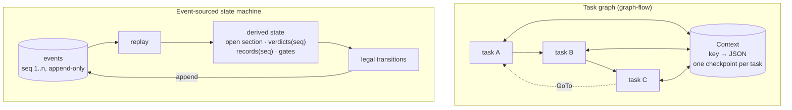
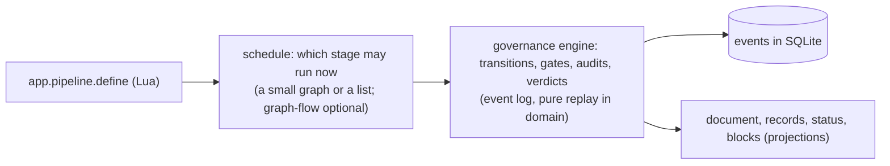

# Task graph versus event-sourced state machine

The research flow is a **graph of tasks** (graph-flow). The proposed discovery is an
**event-sourced state machine**. This note compares the two models as engines for a guided investigation, with the
current code as the example of the first and [discovery-flow.md](discovery-flow.md) as the
example of the second. It ends with when each one is the right tool.

## 1. The two models in one picture

| | Task graph | Event-sourced state machine |
| --- | --- | --- |
| **The state is** | the current node plus a mutable key-value bag | the log; everything else is a projection |
| **Progress means** | "task X ran" | "fact Y is established at seq n, by actor Z" |
| **A step is** | run the next task, save the bag | validate a transition, append an event |
| **Going back is** | `GoTo(earlier task)`; the bag keeps what later tasks wrote | `Reopened { section }`; later facts are hidden by `seq`, not deleted |
| **Who did it** | not modelled | on every event (`Actor`) |
| **History** | the latest checkpoint; earlier ones are overwritten per task | complete and replayable |
| **Invariants live in** | each task's code and a reviewer at the end | the transition rules, checked before appending |

## 2. Where each one shines

### Task graph

- **Natural for ordered work with dependencies.** "Load the plan, then one task per node, then a
  commit" is a graph. The implementation flow (`/implement`) is exactly this and should stay a
  graph.
- **Cheap to write a step.** A node is a function over a context; graph-flow handles scheduling,
  checkpoints and `WaitForInput`.
- **Resumable for free** at task granularity.
- **Mature library** with session storage already adapted (`SqliteFlowStorage`).

### Event-sourced state machine

- **Natural when the deliverable is a set of facts with provenance.** A discovery is "these
  sections are approved by these people from these records", not "these fourteen functions ran".
- **Correct reruns by construction.** A record belongs to the `seq` range of the section open when
  it was produced. Reopen hides the range. No `remove_*` API, no renumbering, no duplicates.
- **Gates as predicates over history.** "Confirmed *after* the `Scope` verdict" is one comparison
  of integers. In a graph the same rule needs a flag per record, cleared by the right `GoTo`,
  which is exactly the code that is missing today.
- **Audit trail and evals come with it.** Human verdicts are already events; goldens are a query.
- **Refusals are explainable.** `status` can say *why* a transition is illegal because it can see
  what is missing.

## 3. Where each one hurts

### Task graph

- **Mutation without ownership.** `ResearchState` has `add_*` and no way to know which run added
  what. Review findings H2 (duplicated evidence), H3 (stale drafts) and M6 (renumbered
  constraints) are all this one weakness.
- **Checks far from producers.** The Critical review knows what a valid Spec is; the Spec node does
  not. A `Back` sends the flow upstream without the error (M2, M3).
- **Answer recorded, fact not.** Prototype saves "the user said yes" but not "the worktree exists",
  so a cancel leaves garbage the rerun cannot clean (H1).
- **No provenance.** A gate approval is a string match on "yes"; nothing says who approved what
  version.
- **Control flow is data-free.** `GoTo` carries a target and a reason string; it cannot express
  "and invalidate everything that depended on the stage I am leaving".

### Event-sourced state machine

- **More design up front.** The event vocabulary and the replay function must be right, and
  changing an event's meaning later needs versioning (a `contract` version field on the event).
- **Two places to reason about.** Rules live in the transitions, effects live in the handlers that
  append; a reader has to hold both.
- **Replay cost grows** with the log. Negligible here (hundreds of events per discovery), but the
  projection should be cached per session anyway.
- **Not a scheduler.** It says what is legal, not what to do next in parallel. Concurrency (three
  Specs at once, Observation ∥ Data ∥ Research) still needs an executor on top.

## 4. A worked example: the user reopens `Scope`

Both engines start with Scope approved, the structural map and three claims confirmed, `Findings`
written and approved, and `Current system` open.

**Task graph (today's model):** `/back definition` issues `GoTo(Definition)`. The bag still holds
the evidence E1…E9, the hypotheses and the drafts. Definition reruns and *adds* constraints C1…C4
again as C5…C8 (or clears and renumbers, breaking the `Decision.discarded` strings). Observation,
if re-entered, appends E10…E18. The Spec later cites both generations. Nothing tells Hypotheses
that its inputs changed. The only invalidation that exists is the user's memory.

**Event-sourced (proposed):** `/reopen scope` appends `Reopened { Scope }`. Replay now shows:
`Scope` open; `Findings` and `Current system` without a verdict; the structural map and the three
claims still *present* but confirmed at `seq < seq(Reopened)`, so `gate_missing(Findings)` lists
them again. The engine reruns Scope, asks for its verdict, and the next records are produced with a
higher `seq`. The old ones are visible in the journal as superseded. No code in any writer had to
know about the reopen.

## 5. A worked example: a cancelled spike

**Task graph:** `prototype.spike` holds `{ id, path, branch }` and the user's "yes". `Ctrl+C` drops
the future after `git worktree add`. On resume, the task reruns `add` and fails ("branch already
exists"); there is no code path that cleans up first because the state does not say the worktree
exists.

**Event-sourced:** `SpikeStarted { worktree, branch }` is appended *before* `add`. On resume the
engine sees a started, unscored spike and runs cleanup first, then `add`. The fix is a rule in the
transition, not a special case in the node.

## 6. Testing

| | Task graph | Event-sourced |
| --- | --- | --- |
| Unit | one node over a `ScriptedLlm`, assert the bag and the blocks | `replay(events) == expected state`; property tests: appending then reopening never shows a later fact |
| Integration | a graph of `FakeNode`s, assert the order of statuses | a scripted event sequence and the legality of each transition (a trail test) |
| Regression of the writer | snapshot of the written files | the same, plus the audit result as data |
| Evals | none today | human verdicts are already the goldens |

## 7. Composability with the Lua pipeline API (roadmap item 5)

`app.pipeline.define{ stages = { … } }` wants stages that are agent turns, Lua functions, commands
or gates, with transitions that branch, go back and loop with a limit. A task graph models the
*schedule* of that well. An event log models the *governance* well: what a stage produced, who
approved it, what a go-back invalidates. The two are not rivals; the honest design is:

The schedule asks the engine "is stage S legal now?" and tells it "stage S produced P". The engine
never schedules; the schedule never judges.

## 8. Recommendation

- **Research / discovery: event-sourced.** The deliverable is facts with provenance, the operations
  that matter are reopen, audit and verdict, and the current defects are all state-ownership bugs
  a graph cannot express.
- **Implementation: keep the graph.** Tasks with dependencies, one commit each, a report; the bag
  is the plan and the plan does not change under it.
- **Shared frame.** Gates in the chat, `/aside`, approval parsing with the decision model,
  cancellation, usage accounting and the explorer agents are engine-agnostic today and should stay
  in one place both engines call.
