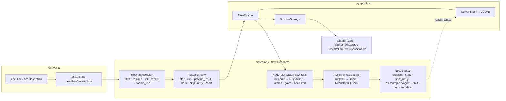
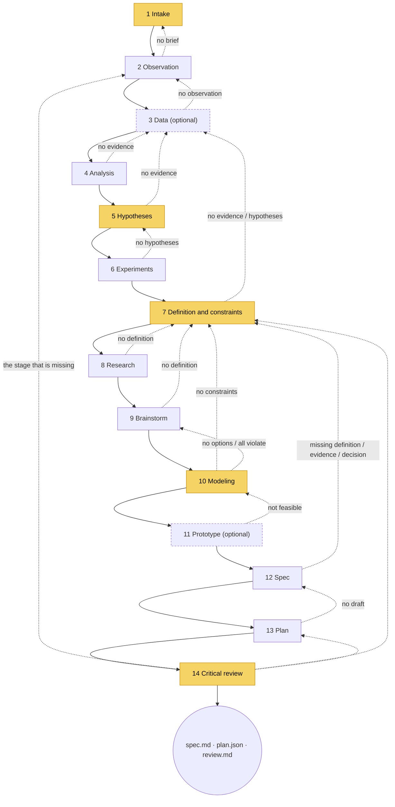
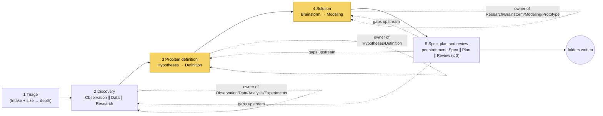
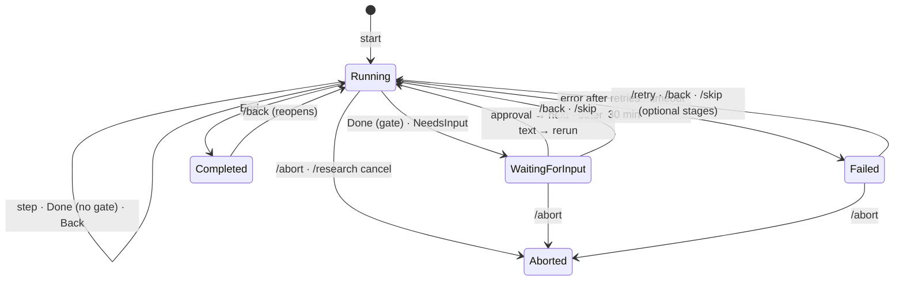

# The research flow as it is today (crest 0.15)

A description of what exists, with diagrams, for whoever decides what replaces it. The findings
about its defects are in [research-flow-review.md](research-flow-review.md); the replacement is
proposed in [discovery-flow.md](discovery-flow.md). User-facing behaviour is documented in
[workflows.md](../workflows.md).

## 1. Shape

`/research <problem>` runs a **graph of tasks** on [graph-flow](https://crates.io/crates/graph-flow).
Each task wraps one *node* (a stage of the Hashlabs X-Workflow). Nodes run in series; a node reads
and writes one shared `ResearchState`, emits blocks to the timeline, and returns one of three
outcomes. Some nodes stop at a *gate* and wait for the user. Every finished node is a checkpoint
in SQLite.



Two graphs exist and a stored session remembers which one it runs (`graph id`):

| Pipeline | Graph id | Stages | Gates |
| --- | --- | --- | --- |
| fast (default) | `research-fast` | 5 | 2 confirm gates, question gates on demand |
| deep (`--deep`) | `research` | 14 | 5 confirm gates, question gates on demand |

## 2. The deep pipeline (14 nodes)

Solid arrows are the normal order. Dashed arrows are the automatic `Back { to }` returns a node
may take when something upstream is missing (the full table is in `workflows.md`, "Automatic
go-backs"). A node with a gate stops after `Done` and asks "yes to go on, anything else to redo".



Yellow nodes have a confirm gate. After three `Back`s from the same stage the fourth becomes a
question to the user instead.

**Roles**: Observation, Data and Research use a read-only agent (`explore` role, 30 model calls,
no approvals, read-only `run_command`); Experiments and Prototype use the chat agent with the
user's approvals (`main`); Hypotheses, Definition, Brainstorm, Modeling, Spec, Plan and Critical
review call the `plan` role without tools.

## 3. The fast pipeline (5 stages)

Each fast stage runs the deep nodes it covers as *steps* inside one task. Independent model calls
run concurrently with `futures` combinators (never `tokio::spawn`, so cancelling the flow cancels
them all) and the blocks are emitted afterwards in a fixed order. A `Back` to a deep stage is
redirected to the fast stage that owns it.



Triage picks a **depth** (quick or standard) that decides how much Discovery does, how many calls
the agent gets (12 or 30) and whether Hypotheses and Brainstorm use `main` or `plan`.

## 4. The node contract

```rust
#[async_trait]
pub trait ResearchNode: Send + Sync {
    fn stage(&self) -> Stage;                       // gate and role come from the stage
    async fn run(&self, ctx: &mut NodeContext) -> Result<NodeOutcome, NodeError>;
}

pub enum NodeOutcome {
    Done,                                   // gated nodes then ask to confirm
    NeedsInput { prompt: String },          // ask; rerun with ctx.user_reply()
    Back { to: Stage, reason: String },     // an earlier stage is missing something
}
```

`NodeTask` turns the outcome into a graph-flow `NextAction`:

| Outcome | NextAction | Stored `FlowStatus` |
| --- | --- | --- |
| `Done`, no gate | `Continue` | `Running { next }` |
| `Done`, last node | `End` | `Completed` |
| `Done`, gated node | `WaitForInput` | `WaitingForInput { stage, prompt }` (kind `Confirm`) |
| `NeedsInput` | `WaitForInput` | `WaitingForInput` (kind `Question`) |
| `Back { to }` | `GoTo(to)` | `Running { next: to }` |
| `Err`, transient, < 2 retries | rerun in place | — |
| `Err`, otherwise | `TaskExecutionFailed` | `Failed { stage, error }` |

## 5. The flow as a state machine of *status*

The flow itself has a small status machine, stored under the key `research.status`:



What this machine does **not** know: which artifacts are established, by whom, and from which
version of their inputs. It only knows which node runs next.

## 6. What is stored

Everything lives in graph-flow's `Context`, a key → JSON map saved as one checkpoint per finished
task in `SqliteFlowStorage`. The frame owns the keys with the prefix `research.`; nodes may store
anything else.

| Key | Content |
| --- | --- |
| `research.state` | the whole `ResearchState`: evidence, hypotheses, constraints, decisions, journal, problem statements, reports |
| `research.problem` | the user's request |
| `research.status` | the `FlowStatus` above |
| `research.gate` / `research.reply` | the pending gate and the answer being delivered |
| `research.entered` | last stage whose `StageHeader` was emitted |
| `research.backs` | `Back` count per requesting stage |
| `research.usage` | time, calls, tokens, cost per stage |
| `research.depth` | depth the user asked for |
| `prototype.spike`, `<stage>.resume_at`, drafts… | node-private data |

Plus an *index session* per workspace (`research-index:<root>`) with the ids of every flow, so
`/research list`, `resume <n>` and `cancel` can find them.

`ResearchState` is a **mutable bag with append-only helpers**: `add_evidence`, `add_hypothesis`,
`add_constraint`, `add_decision`, `log`. There is no `remove_*`, and a record does not know which
run of which stage produced it. That is why reruns accumulate (review finding H2) and why
`Definition` must renumber constraints wholesale (M6).

## 7. What it writes

```text
.crest/specs/NNNN-slug/
  spec.md        10 sections, for people
  plan.json      tasks, dependencies, acceptance, hypothesis and constraint tests
  plan.md        rendered plan
  journal.md     the research journal (rewritten by the Plan node)
  sources.json   the cited evidence
  review.md      the critical review
  evidence/*.csv the charts' data
  simulation/    by /simulate, later
```

Written straight through the file-system port by `FsSpecSink`, without approvals, confined to the
workspace and to `.crest/specs`.

## 8. The gate dialogue

- A **confirm** gate accepts approvals (`yes`, `ok`, `sí`, `vale`, an empty line…) and treats any
  other text as a correction that reruns the node with `user_reply`. "yes, but…" is a correction.
- A **question** gate takes any text as the answer.
- The decision model, when configured, reads free text at a gate with confidence ≥ 0.7.
- `/aside` opens a side chat without rerunning the stage; `/flow` returns to the gate.
- Nothing records *who* answered or *what* the approved artifact looked like at that moment.

## 9. Judgement today

| Where | What is checked | How |
| --- | --- | --- |
| Definition | that each problem statement is measurable | a heuristic plus the decision model, then the model's own second opinion; a question gate if it still is not |
| Plan | `plan.json` validity (ids, dependencies, cycles, files) | deterministic |
| Critical review | unknown `[E…]` citations, empty sections, uncited background, missing cited files, constraints without tests, plan without hypothesis or constraint tests; then **serious gaps** | deterministic checks, then a clean-context subagent answering JSON `Gap { claim, problem, severity, to }` |
| Spike | feasible or not | the chat agent's own verdict |

Checks live only in the reviewer, not in the producers; the review's `Back` sends the flow to the
owning stage without telling it what to fix (review findings M2, M3).

## 10. Size

| Area | Lines |
| --- | --- |
| frame (`flow`, `session`, `task`, `node`, `gate`, `builder`, `graph`, `commands`, `depth`, `usage`, `agents`, `json`) | ≈ 5,100 |
| 14 deep nodes | ≈ 9,700 |
| 5 fast stages | ≈ 1,650 |
| `domain::research` | ≈ 1,250 |
| drivers in `bin` | ≈ 660 |
| tests inside the above | a large share; every node has scripted-model tests |

## 11. What to keep whatever replaces it

- The node contract's separation of *what the model does* from *what the frame enforces* (gates,
  retries, back limit, checkpoints, usage accounting).
- The read-only explorer agent and the filtered acting agent.
- Concurrent steps with `futures` combinators and cancellation through the flow's `CancelToken`.
- The side chat (`/aside`, `/flow`) and the approval phrase parsing with the decision model.
- The deterministic checks of the Critical review and the plan validator.
- `FsSpecSink` and the folder layout: `/implement` and `/simulate` depend on it.
- The scripted-model and fake-node test style, and the `insta` snapshots of what gets written.
